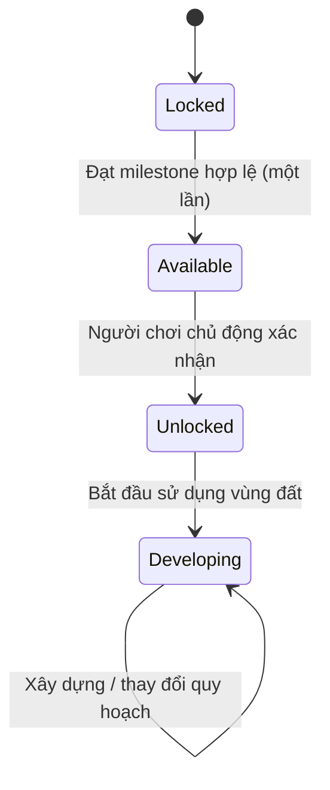
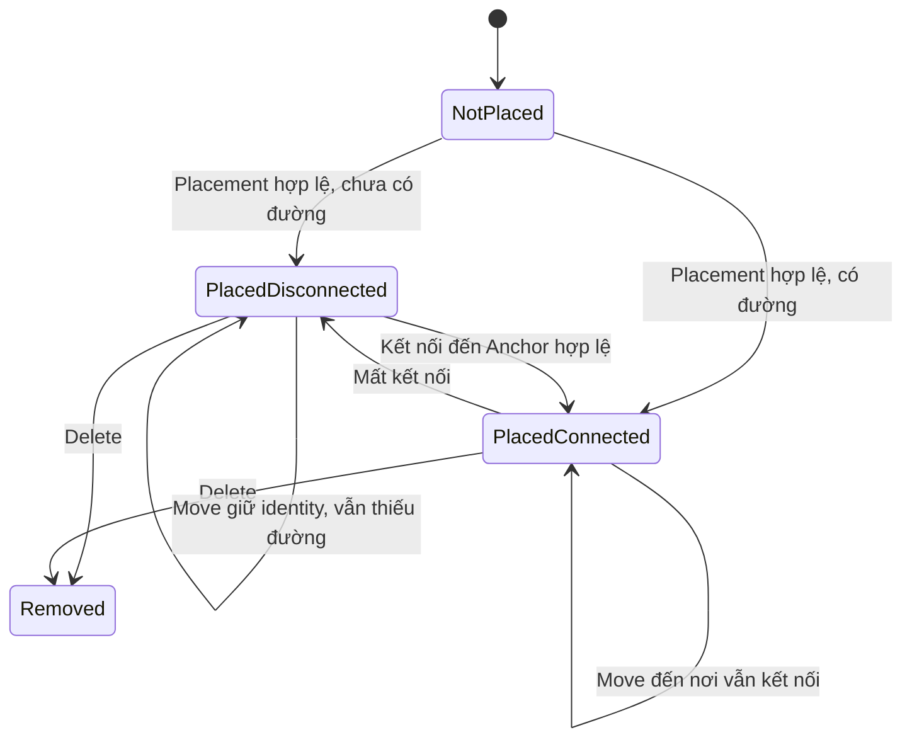
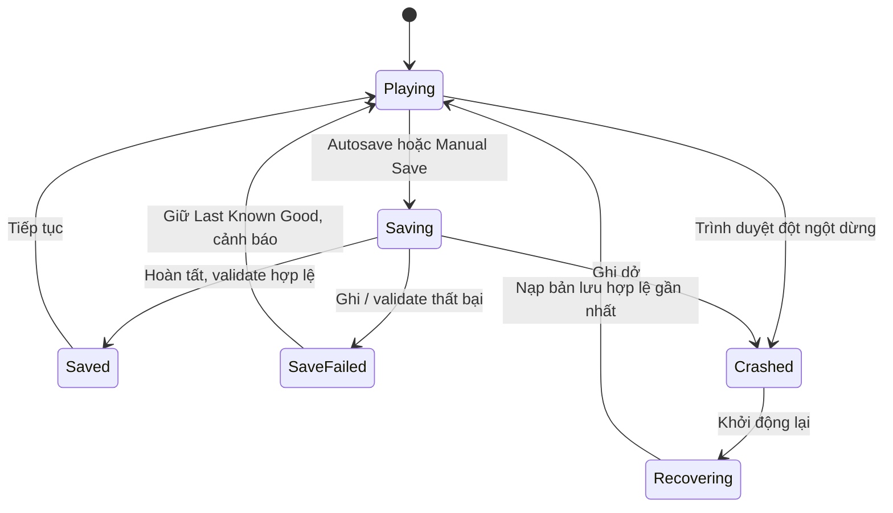
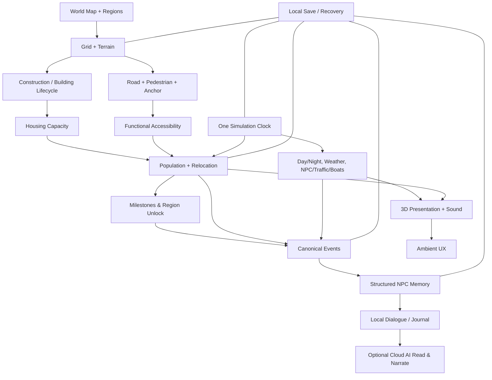

# LITTLE COAST
## Game Design Document — Candidate v1.0

> **Tình trạng:** DRAFT / CANDIDATE — **CHƯA PHÊ DUYỆT**  
> **Ngày biên soạn:** 22/10/2026  
> **Nguồn yêu cầu:** Product Discovery v0.1–v0.11.8, các vòng Decision Closure đã được người chơi xác nhận.  
> **Phạm vi:** Product/Game Design cho Vertical Slice, Focused MVP, định hướng Post-MVP.  
> **Ngoài phạm vi tài liệu:** Code, chọn engine/stack, Technical Design, ước lượng timeline/ngân sách triển khai, tự động quyết định các mục OPEN/CANDIDATE.

---

# 0. Document Control & Decision Semantics

GDD này là **tài liệu dự thảo để review**, không phải bản thiết kế đã khóa. Những phát biểu có tính bắt buộc chỉ được hiểu là yêu cầu chính thức nếu truy vết được tới quyết định **CONFIRMED**. Nội dung chưa được xác nhận phải giữ nhãn.

| Nhãn | Ý nghĩa | Cách sử dụng trong GDD |
|---|---|---|
| **CONFIRMED** | Người chơi đã phê duyệt rõ | Quy tắc sản phẩm bắt buộc, không tự thay đổi |
| **PARTIAL** | Một phần được phê duyệt, chi tiết còn mở | Phải chỉ rõ phần nào đã chốt |
| **PROPOSED** | Phương án thiết kế đề nghị phê duyệt | Không triển khai như yêu cầu bắt buộc khi chưa duyệt |
| **OPEN** | Còn thiếu quyết định sản phẩm | Không suy đoán hoặc tự lấp chỗ trống |
| **BALANCE CANDIDATE** | Số liệu giả định để playtest | Thay đổi được sau thử nghiệm, không phải luật đã chốt |
| **PROTOTYPE GATE** | Cần thử nghiệm trực quan/kỹ thuật để chọn | Không chốt bằng suy đoán |
| **DEFERRED / POST-MVP** | Ngoài giai đoạn đầu | Không đưa vào phạm vi MVP nếu chưa có phê duyệt thay đổi |

**Quy tắc thay đổi:** Mọi điều chỉnh làm thay đổi CONFIRMED gameplay rules cần được ghi thành change request, giải thích tác động liên hệ chéo (world, population, time, persistence, AI), cập nhật acceptance tests. Không dùng số lượng tính năng hay “% hoàn thiện” thiếu cơ sở để tuyên bố sẵn sàng phát hành.

# 1. Game Overview

## 1.1. Tầm nhìn

**Little Coast** là game **Cozy City Builder / Light Simulation / Living World** trên trình duyệt desktop. Người chơi xây dựng và chăm sóc một làng chài ven biển Việt Nam trong thế giới **3D Isometric, Cozy Stylized 3D**, từng bước phát triển thành thị trấn ven biển có nhiều khu vực. Một bờ biển cong, bến cá, nhà mái ngói/tôn, ngõ nhỏ, cây xanh, tàu đánh cá, xe máy, đồi và hải đăng tạo nên bản sắc không gian.

Game khuyến khích tự do sáng tạo và quan sát; **không sử dụng tiền hoặc vật liệu để trả chi phí đặt công trình**. Phát triển thành phố được thể hiện thông qua cư dân có chỗ ở hợp lệ, mạng tiếp cận, cảnh quan, hoạt động sống và các mốc phát triển có ý nghĩa. Người chơi có thể quan sát trong Ambient Mode; NPC đặc biệt có ký ức và câu chuyện, nhưng AI chỉ đóng vai trò kể chuyện — không phải luật chơi.

## 1.2. Ba trụ cột (CONFIRMED qua Focused Scope)

1. **Meaningful Building:** Quy hoạch tạo tác động đến khả năng ở, giao thông, tiện ích và nhịp sống; không chỉ thay đổi hình ảnh hoặc cộng chỉ số ngay khi đặt công trình.
2. **Living Ambient:** Thành phố có thời gian, thời tiết, cư dân, thuyền, phương tiện, âm thanh và hoạt động để đáng ngắm ngay cả khi người chơi không xây.
3. **Memorable World:** Sự kiện có thật và tương tác với Named NPC tạo ký ức có nguồn gốc; nhật ký giúp thành phố có lịch sử riêng.

## 1.3. Người chơi mục tiêu và trải nghiệm

- Người thích xây dựng, chỉnh sửa một khu phố đẹp, ít trừng phạt.
- Người muốn mở game như một sa bàn ven biển thư giãn, nghe âm thanh và quan sát nhịp sống.
- Người yêu thế giới có câu chuyện, NPC có cá tính nhưng không cần đối thoại liên tục.
- **Desktop browser first**; cấu hình thiết bị tối thiểu, độ phân giải tối thiểu và mobile scope **OPEN**.

## 1.4. Bản sắc và ranh giới

**CONFIRMED:** Việt Nam ven biển, làng chài phát triển thành phố; đường bờ và địa hình tổng thể được bảo vệ; bản đồ liên tục thiết kế sẵn với Region khóa/mở; grid xây dựng; nhà không tốn tiền; NPC đặc biệt bảo toàn danh tính/ký ức; không có hậu quả âm thầm do thời gian offline.

**Phạm vi MVP loại trừ hoặc chưa có yêu cầu:** multiplayer; kinh tế thuế/tiền/tài nguyên; chuỗi cung ứng phức tạp; terraforming tự do, lấn biển; thiên tai phá hủy; tắc đường chuyên sâu; Cloud AI NPC chạy liên tục; AI trực tiếp xây/xóa; Voice NPC; cloud-sync nhiều thiết bị; desktop wallpaper OS; sinh map vô hạn. Chi tiết post-MVP ở §11.

# 2. Player Experience & Core Loops

## 2.1. Core loop (định hướng cấu trúc từ các quyết định CONFIRMED)

**Khám phá vị trí → Đặt/chỉnh nhà, đường, tiện ích, cảnh quan → Hình thành khả năng tiếp cận thực → Tái định cư ưu tiên hoặc cư dân mới chuyển đến theo thời gian → Khu phố sống động hơn → Đạt milestone → Region Available → Người chơi chủ động Unlock → Tiếp tục sáng tạo / Ambient / trò chuyện NPC.**

Không tự gán cư dân vào nhà ngay khi xây. Nhà thêm **sức chứa**; dân cư mới được xét theo Housing Eligibility, Relocation Priority và City Arrival Budget.

## 2.2. Ambient loop

**Chọn góc nhìn → Living / Slow / Scenic Pause → Ngắm thời gian, thời tiết, NPC, tàu và âm thanh → Xem thông tin, Journal hoặc chủ động trò chuyện → Quay về Building khi muốn**.

Ambient không bắt buộc phải có các popup thành tựu, không tự đổi camera vì sự kiện hiếm, không buộc người chơi trả lời NPC. Các lựa chọn camera tự động, nhạc/preset cụ thể: **PROPOSED / OPEN**.

## 2.3. Narrative loop

**Canonical Event hoặc Player Interaction hợp lệ → Structured Memory có nguồn và phạm vi nhận biết → Local Template → Optional Cloud AI theo yêu cầu → Kiểm tra tính hợp lệ → Hiển thị và chỉ lưu kết quả hoàn tất**.

AI **không trực tiếp** điều khiển World State hoặc tạo/kích hoạt Gameplay Event (**D36/D42 CONFIRMED**).

# 3. World, Regions, Terrain

## 3.1. Map & geography

- **CONFIRMED:** Một bản đồ **liên tục, được thiết kế sẵn**, có các Region mở dần; không tạo map vô hạn; có hình thái làng chài, bờ biển, vùng đất, đồi, hải đăng, không gian biển.
- **CONFIRMED Focused Scope:** Vertical Slice = một phần **Làng Chài** + dải/vùng mở rộng thử; MVP = **Làng Chài + Xóm Biển** đều có thể xây dựng; các Region tiếp theo ngoài MVP.
- **CONFIRMED REGION-02:** Xóm Biển tiếp nối Làng Chài; khu dân cư ven biển, quán nhỏ, lối dạo, cây xanh, nhịp sống khu phố; không tự hiện đại hóa hoặc ghi đè Làng Chài.
- **OPEN:** diện tích, chính xác hình dạng đường bờ, điểm lên/xuống cao độ, phân bổ lô đất, Access Anchor, vị trí landmark, lối chuyển Region.

## 3.2. Region state machine

**UNLOCK-01/02/03 CONFIRMED:** Region có 2–3 điều kiện có ý nghĩa theo tính chất khu vực; milestone ghi nhận một lần, không thu hồi; Region đạt yêu cầu thành `Available`, chờ người chơi xác nhận thành `Unlocked`. Nếu dân số giảm sau đó, quyền `Available/Unlocked` không mất. `Developing` là trạng thái diễn giải UX/analytics, không bắt buộc là một trạng thái lưu riêng.

**REGION-02 unlock concept:** Connected Population + thành tựu phát triển khu phố là hướng đề xuất đã nằm trong concept Xóm Biển; số điều kiện cụ thể, ngưỡng, quy tắc AND/OR/alternative và danh sách achievement **OPEN/BALANCE CANDIDATE**, cần duyệt trước Approved GDD.

## 3.3. Terrain Editing — D09 CONFIRMED

- Hỗ trợ **Manual Terrain Editing** và **Assisted Terrain Preparation** khi công trình cần nền phù hợp.
- Xem trước ảnh hưởng của việc chỉnh nền; người chơi xác nhận trước khi áp dụng phần địa hình thay đổi.
- Giới hạn **chỉnh nhẹ**, không san phẳng núi, không lấn biển, không âm thầm sửa bờ biển/vách đá hoặc đất bảo vệ.
- Khi placement đi kèm Assisted Preparation: kết quả phải **toàn bộ hợp lệ hoặc không áp dụng thay đổi**.
- Chỉnh sửa thủ công không được làm hỏng công trình/đường hiện hữu ngoài phạm vi đã thông báo; xử lý xung đột bằng từ chối hoặc preview cần xác nhận.

**D14 CONFIRMED:** Xóa hoặc di chuyển công trình **không tự phục hồi địa hình** đã chỉnh. Chỉnh nền lần sau là một thao tác độc lập, phải qua validation. Nút “restore original terrain” chuyên dụng, kích thước vùng chỉnh, độ dốc tối đa, mép chuyển tiếp: **CANDIDATE/OPEN**.

# 4. Construction & Roads

## 4.1. Grid placement

Đặt công trình trên Grid, hỗ trợ preview, xoay, di chuyển, xóa. **Validity** (được đặt) không đồng nghĩa **Functionality** (có thể hoạt động). Placement phải kiểm tra Region Unlocked, footprint, collider, địa hình, cao độ, loại công trình và các vùng được bảo vệ.

**D08 / POP-01 CONFIRMED:** Nhà trên đất hợp lệ có thể đặt dù chưa có đường. Nhà thiếu Functional Accessibility không nhận cư dân mới hoặc tái định cư; cư dân đã ở không bị đẩy ra chỉ vì đường mất kết nối.

**D12 CONFIRMED:** Move nhà giữ Building Identity, occupants, Named NPC, memories, history; cập nhật position/orientation, access, tuyến NPC, các hiệu ứng địa phương. Nếu Move đến nơi không đường, cư dân cũ vẫn ở, không nhận người mới. Không Move đến Region Locked hay footprint không hợp lệ. Move thất bại giữ nguyên trạng thái cũ.

**D14 CONFIRMED:** Remove building chấm dứt vòng đời công trình, giải phóng footprint, kích hoạt Soft Relocation nếu cần; không tự hoàn nguyên đất, không xóa đường/cây độc lập.

**OPEN/CANDIDATE:** build animation/delay (D13), giới hạn undo/redo, công trình được phép Move/Rotate, kích thước grid D16, trang trí trong ô D17, chính sách xóa đường có xe (D15) ở cấp thao tác chi tiết. Nguyên tắc an toàn trạng thái đã được đề xuất làm acceptance.

## 4.2. Road Connectivity — D10/D11 CONFIRMED

- Đường dân sinh và lối đi bộ có thể liên thông tại **điểm nối hợp lệ**.
- Nhà có thể đón người qua tuyến đi bộ, không nhất thiết xe chạy đến cửa.
- Không buộc toàn thành phố vào một mạng đường trung tâm.
- Mỗi cụm dân cư có thể hoạt động độc lập nếu có tuyến hợp lệ đến **Access Anchor đang hoạt động**.
- Đứng cạnh một ô đường biệt lập **không đủ** được xem là đã kết nối.
- Các loại hình đường có quyền truy cập khác nhau; xe không tự chạy trên tuyến chỉ dành cho người đi bộ.
- Region là giới hạn quyền xây dựng, không được tùy tiện chặn chuyển động tại ranh giới nếu đường nối hợp lệ.

**Access Anchor (khái niệm sản phẩm đã chốt):** điểm ra/vào hợp lệ của dòng người hoặc hoạt động. Ví dụ đường ra đất liền, District Connector hoặc cảng hành khách nếu được thiết kế chức năng đó. **Không suy ra** mọi bến cá tự là Anchor. Số lượng, vị trí, loại và quy tắc hình học Anchor: **WORLD DESIGN CANDIDATE**.

## 4.3. Building functional states — mô hình đề xuất để review

`PlacedDisconnected` có sức chứa và có thể còn cư dân cũ, nhưng **không** có tư cách tiếp nhận người mới. Di chuyển giữa connected/disconnected không tự sinh/xóa residents. Phần thể hiện cụ thể của các trạng thái: **GDD detail candidate**.

# 5. Population, Housing & Relocation

## 5.1. Population accounting — POP-02/05 CONFIRMED

- **City Population** = người còn cư trú/thuộc thành phố, gồm Housed, Waiting, At Risk; không gồm Departed/Named NPC đã thực sự tạm rời đi.
- **Housed Population** = người đang có nhà, kể cả trong nhà vừa mất kết nối.
- **Connected Population** = tập con Housed Population đang ở trong nhà tiếp cận Anchor hợp lệ; dùng cho milestone dân cư.
- **Relocation Population** = Waiting + At Risk; không chiếm sức chứa bất kỳ ngôi nhà nào.
- Một Named NPC có thể giữ hồ sơ/memory khi `Temporarily Away` mà **không** được cộng như người đang cư trú nếu thực tế đã rời thành phố.

**Invariants:** Một cư dân không đồng thời thuộc hai trạng thái cư trú loại trừ nhau; một chỗ ở không bị cấp cho nhiều cư dân; `Occupied + Reserved <= Physical Capacity`; thống kê không cộng trùng; Relocation không làm tăng City Population.

## 5.2. Housing eligibility — POP-01 CONFIRMED

Nhà chỉ nhận cư dân mới/tái định cư nếu tồn tại hợp lệ, còn chỗ thực, được kết nối đến mạng tiếp cận/Anchor hợp lệ, không đang bị xóa hoặc Move chưa hoàn tất. Amenities/landscape **không bắt buộc** để cho phép tăng dân (POP-04), nhưng giúp tăng trưởng thuận lợi hơn.

Nhà bị ngắt kết nối: cư dân đã ở tiếp tục ở; người mới và người chờ tái định cư không được chuyển đến; Connected Population tính lại; không tự kích hoạt mất nhà hoặc Relocation.

## 5.3. Relocation state machine — REL-01/02/03/05/06 CONFIRMED

```mermaid
stateDiagram-v2
    [*] --> Housed
    Housed --> Housed: Move nhà, giữ cư dân và Building ID
    Housed --> Waiting: Nhà bị Delete; chưa có nơi thay thế
    Housed --> Housed: Nhà bị Delete nhưng bố trí ngay nơi khác hợp lệ
    Waiting --> Housed: Được bố trí nhà hợp lệ
    Waiting --> AtRisk: Đủ 3 ngày Simulation Time, chưa có nhà
    AtRisk --> Housed: Được bố trí nhà hợp lệ
    AtRisk --> DepartureEligible: Đủ thêm 1 ngày game tích lũy trong Building
    DepartureEligible --> Housed: Có nhà, tái định cư trước Departure
    DepartureEligible --> Departed: Cư dân nền, theo từng đợt chỉ trong Building
    DepartureEligible --> TemporarilyAway: Named NPC, không xóa identity/memory
    TemporarilyAway --> Housed: Có điều kiện trở lại theo ưu tiên
```

**Không hiểu nhầm trạng thái:** `DepartureEligible` là trạng thái giải thích riêng cho điều kiện sau bảo vệ, **không** đồng nghĩa Departed. Thời điểm Named NPC tạm vắng/được phục hồi chi tiết, cách giải quyết nhóm hộ gia đình: **OPEN/detail**, luôn bảo toàn hồ sơ và ký ức.

- **Waiting:** 3 ngày *game*; chạy trong Building/Living, chậm trong Slow, dừng Scenic Pause và game away.
- **Protected Ambient:** Khi Waiting hết hạn trong Ambient Living/Slow → At Risk, **không Depart** trong Ambient.
- **At Risk Building Protection:** Thêm **1 ngày game tích lũy ở Building**; Ambient không tính tiếp bộ đếm này, không reset nếu đổi mode.
- **Departure:** Chỉ cư dân nền hết bảo vệ mới có thể rời **từng đợt khi Building đang hoạt động**; luôn kiểm tra tái định cư trước một lượt Departure.
- **Named NPC:** Không được xóa identity, memories, relationships; có thể tạm vắng mặt sau giai đoạn bảo vệ theo trạng thái hợp lệ.
- **D20:** Đóng game/tab không hoạt động không làm bất kỳ timer nào tiến lên, không tính bù offline.

**Balance Candidate:** tối đa **1 cư dân nền/ngày game** sau bảo vệ; chưa phê duyệt tốc độ thực tế.

## 5.4. Allocation order — POP-03 CONFIRMED

**At Risk → Waiting → Named NPC chờ trở lại → New Residents.** Trong cùng nhóm, ưu tiên đã chờ lâu hơn; cách hòa đồng hạng, phân bổ gia đình và phù hợp từng loại nhà: **DETAIL OPEN**. Mọi vị trí nhận phải đáp ứng Housing Eligibility. Không lấy slot của người chờ để đón người mới.

## 5.5. Growth — GROW-01/02/03; POP-04 CONFIRMED

- Tăng dân mới là **External Arrival**, tách hẳn với Internal Relocation.
- Tồn tại mức **City Arrival Budget theo chu kỳ**, không tỷ lệ trực tiếp với số nhà được spam.
- Ưu tiên phân bổ nhà cho cư dân cũ rồi mới xét External Arrival.
- Phân bổ cư dân mới giữa khu có sức chứa hợp lệ, xét yếu tố địa phương; không bỏ quên vô hạn các khu ít tiện ích.
- Không yêu cầu công viên/quán/cây mới cho phép có dân: tiện ích và cảnh quan ảnh hưởng nhịp phát triển, không phải cửa khóa cứng.
- Nhịp tăng trưởng có thể thay đổi theo giai đoạn phát triển thành phố.
- FPS, camera và số NPC 3D đang hiển thị **không được** ảnh hưởng population logic.

Công thức khái niệm (chưa chốt cách tính/hệ số):

`EligibleVacancies = Σ max(0, capacity - occupied - reserved)` trên các nhà đủ điều kiện, **sau** relocation.

`NewArrivalsPerTick ≤ min(EligibleVacancies, CityArrivalBudgetForTick)`.

**Balance Candidate:** Làng Chài có thể thử 1–2 cư dân mới/ngày game khi đủ điều kiện. Không có chỉ tiêu cố định cho MVP.

## 5.6. Progression — UNLOCK-01/02/03 CONFIRMED

- Milestone dân cư dùng **Connected Population**, không dùng người Waiting/At Risk hay đơn thuần số nhà.
- Achievement ghi nhận lần đầu; không cộng lại do đặt/xóa, nối/ngắt đường liên tục.
- Mở Region cần 2–3 điều kiện có ý nghĩa theo loại khu, có thể kết hợp dân cư, cảnh quan, thành tựu.
- Khi đạt, Region thành `Available`; người chơi chủ động Unlock; sau đó không bị thu hồi.
- Các điều kiện mở Region phải có thể đạt **bằng nội dung đã có trước khi mở chính Region đó**, không có phụ thuộc vòng hoặc sự kiện cá voi ngẫu nhiên bắt buộc.
- **OPEN/BALANCE:** ngưỡng Connected Population, nội dung achievement Region 02, thời lượng đến unlock, lựa chọn AND/OR nếu có nhiều đường hoàn thành.

# 6. Time, Ambient & Weather

## 6.1. Single authoritative Simulation Clock — D18/D19, TIME-01–04, D20

- **CONFIRMED D18:** Một ngày game trong khoảng **20–30 phút thực**; **24 phút** chỉ là Balance Candidate.
- **CONFIRMED D19:** Ambient có Living, Slow, Scenic Pause.
- **CONFIRMED TIME-02:** Một Simulation Clock có thẩm quyền. Đổi mode chỉ đổi tốc độ, không đặt lại clock, lịch NPC, Waiting/At-Risk timers hay bộ đếm sự kiện.
- **CONFIRMED D20/TIME-01:** Khi tab ẩn/đóng hoặc không hoạt động theo visibility-based pause thì dừng, **không catch-up offline**. Game vẫn hiển thị trên màn hình có thể tiếp tục chạy khi ứng dụng khác có focus; việc mất focus đơn thuần không mặc định là game ẩn. Phải ứng xử nhất quán trong giới hạn visibility/lifecycle của browser.
- **CONFIRMED TIME-03:** Scenic Pause đóng băng simulation nhưng người chơi có thể xem thông tin, lưu, đọc Journal và chủ động trò chuyện; decorative animations, sóng/gió/audio có thể tiếp tục.
- **CONFIRMED TIME-04:** Scenic Pause giữ **Weather Simulation State**; muốn đổi trạng thái thời tiết mô phỏng phải trở lại mode có clock chạy.

| Chế độ | Simulation progression | Decorative presentation | Chờ tái định cư (3 ngày) | Building Protection (1 ngày) | Departure |
|---|---|---|---|---|---|
| Building | 1× | Chạy | Chạy | Chạy | Có thể sau đủ điều kiện |
| Ambient Living | 1× | Chạy | Chạy | Dừng | Không |
| Ambient Slow | <1×, cụ thể OPEN | Chạy hợp lý | Chạy chậm | Dừng | Không |
| Ambient Scenic Pause | 0× | Chạy không canonical | Dừng | Dừng | Không |
| Tab ẩn / app dừng / game đóng | 0× | Có thể dừng | Dừng | Dừng | Không |

**Presentation Time != Simulation Time:** Game có thể hoạt họa sóng, lá, đèn và chuyển tiếp giao diện ở Scenic Pause, nhưng các chuyển động này không được gây tiến trình, tạo event canonical hoặc phát sinh Memory giả. Mọi event/timer chỉ được xử lý một lần ngay cả khi đổi mode hoặc khôi phục phiên.

**Tương tác trong pause:** Hội thoại người chơi chủ động là sự kiện tương tác thật, có thể lưu vào Interaction History bằng thứ tự tương tác, dù Game Time giữ nguyên. Đó không tự trở thành sự kiện gameplay thế giới.

## 6.2. Weather — WEATHER-01–04 CONFIRMED

- MVP ưu tiên thời tiết nhẹ, **không có thiên tai phá hủy công trình**.
- Thời tiết hỗ trợ **Ambient Presentation và NPC Behavior**, không trực tiếp thưởng tốc độ phát triển cây, dân cư, du lịch hoặc milestone chỉ vì đổi thời tiết.
- Có **Auto/Manual**; Manual có thể giữ trạng thái mong muốn cho đến khi người chơi đổi hoặc quay lại Auto.
- Nhật ký và AI chỉ nói về tình trạng thời tiết như dữ kiện thật khi World State xác nhận. Không thể nhấn đổi thời tiết nhiều lần để farm phần thưởng.
- Trong Scenic Pause, không chuyển Weather Simulation State (TIME-04); có thể tiếp tục rain/sun ambient animation của trạng thái đang được giữ.
- Chuyển thời tiết phải đủ dễ chịu để nhìn lâu, không gây nhấp nháy, spike âm thanh hoặc làm vô hiệu hóa mọi hoạt động khi Manual Rain được giữ lâu.

**WEATHER CONTENT CANDIDATE:** Sunny / Cloudy / Light Rain; chi tiết loại thời tiết, tần suất, sức gió, thời gian chuyển, lịch NPC: chưa chốt.

## 6.3. Living World

Các hoạt động có chủ đích mang bản sắc: đi bộ, sinh hoạt nhà/cửa hàng, xe máy/xe nhỏ, tàu đánh cá ra về, đèn nhà và hải đăng, chim/biển/gió, hiếm gặp cá voi ngoài khơi. Không cần mọi hành động là Agent hoặc Event trong journal. Mô phỏng cư dân nền, xe cộ và tàu ở mức tổng hợp hợp lý; đối tượng 3D có thể dùng virtualization/LOD ngoài màn hình mà không làm thay đổi World State.

**Lighthouse/whale:** Thuộc tầm nhìn sản phẩm; một hoạt cảnh cá voi và ánh hải đăng là candidate cho MVP theo scope đã thảo luận. Nếu vị trí Mũi Hải Đăng nằm ngoài hai Region xây dựng, phần hải đăng có thể là landmark nền, không có nghĩa Region đầy đủ đã unlock. Cơ chế thông báo, độ hiếm và điều kiện achievement cá voi **OPEN**, không chặn mở Region chính.

# 7. NPC, Hybrid AI, Memory & Journal

## 7.1. NPC tiers — cấu trúc thiết kế đề xuất

| Tầng | Vai trò | AI |
|---|---|---|
| Ambient NPC | Tạo mật độ nhịp sống, có thể dùng thống kê và diễn hoạt theo điều kiện | Không tự gọi LLM |
| Resident NPC | Hoạt động và thoại ngắn theo template, không nhất thiết có ký ức phong phú | Local-first |
| Named/Special NPC | Identity, profile, relations, memories, dialogue, lịch hoạt động | Cloud AI **on-demand** khi tương tác phù hợp |

Tầng NPC và số lượng mỗi tầng: **CONTENT/TECHNICAL CANDIDATE**. **CONFIRMED:** Named NPC bảo toàn hồ sơ/ký ức qua Move, mất nhà và vắng mặt; số lượng NPC render không quyết định dân số logic.

## 7.2. Dialogue — D30 CONFIRMED

**Hybrid Dialogue:** Câu hỏi gợi ý/Local Template + chat tự do khi người chơi chủ động sử dụng. Không bắt mọi NPC có Free Chat. AI dùng context từ World State, sự kiện và Memory được phép biết; khi mất Cloud AI vẫn có fallback cục bộ và mô phỏng tiếp tục. Nội dung lời nói không làm thay đổi World State.

**Fact/source policy (yêu cầu bảo vệ tính nhất quán từ Hybrid AI, thiết kế review):**

1. **Canonical World Facts:** sự kiện/trạng thái được xác nhận bởi mô phỏng.
2. **Witnessed/Told Facts:** điều NPC thực sự chứng kiến, nghe kể hoặc biết qua ngữ cảnh có thẩm quyền.
3. **Player Claims:** phát biểu của người chơi, lưu như lời kể, không coi mặc định là Canonical Fact.
4. **Creative Narration:** cách kể và cảm xúc, không được tự xác nhận công trình, dân cư, thời tiết hay sự kiện cụ thể chưa xảy ra.

Cloud AI Response trễ sau khi người chơi Move công trình, đổi trạng thái hoặc chuyển Save cần được kiểm tra tính còn hiệu lực trước khi hiển thị/lưu như dữ kiện hiện tại. Không tự retry vô hạn. Thời gian chờ/timeout và quota: **OPEN**.

## 7.3. Cloud authority — D36/D42 CONFIRMED

**Cloud AI = Read + Narrate**, không tự Schedule/Trigger Gameplay Event, xây/xóa/move nhà, thêm dân, mở Region, thay đổi Weather Simulation State, sửa NPC identity hay ghi Canonical World Fact mới. NPC có thể *nói* họ mong muốn một công viên nhưng điều đó **không tạo công viên hoặc quest mới**. Nếu sau này có quest dựa trên lời kể, luật tạo quest phải được thiết kế và phê duyệt riêng.

## 7.4. Structured Memory & Provenance

Ký ức thuộc Named NPC cần đủ khả năng ghi nhận nguồn, chủ thể, thời gian game, mức nhận biết và mối liên hệ với công trình/sự kiện để không trộn quá khứ và hiện tại. Memory về nhà cũ vẫn đúng theo lịch sử khi nhà đã Move; vị trí hiện tại lấy từ World State có thẩm quyền. Memory qua các bản lưu và phiên chơi phải bền vững; **storage topology, retention, pruning/summarization, cloud privacy, số ký ức và quan hệ** vẫn OPEN/CANDIDATE.

## 7.5. Journal — D35 CONFIRMED

**Event-driven Journal:** Sự kiện đáng nhớ được ghi nhận cục bộ bằng Local Template có nguồn gốc; Cloud AI chỉ làm giàu khi người chơi yêu cầu. Không bắt buộc mỗi ngày có trang Journal; không tạo entry cho mỗi xe đi qua hoặc thời tiết thông thường. Journal entry lịch sử giữ đúng thời điểm và sự kiện gốc, không tự viết lại quá khứ khi công trình di chuyển. Tạo entry một lần cho mỗi sự kiện thích hợp, mở lại Journal không tự gọi AI. Phản hồi AI chưa hoàn tất không được đánh dấu là bản ghi đã lưu.

**Sự kiện ứng viên:** lần đầu đạt milestone, Region Unlock, mốc dân cư quan trọng, sự kiện Named NPC có ý nghĩa, cá voi xuất hiện (không tự nói người chơi đã nhìn thấy). Journal cadence chính xác, style, phạm vi sự kiện: **CONTENT/QUALITY CANDIDATE**.

# 8. Visuals, Camera, Ambient UX, Audio

## 8.1. Art — D43 CONFIRMED

**Cozy Stylized 3D** trong không gian ven biển Việt Nam; hình khối và chất liệu có sự thống nhất, tỷ lệ house/NPC/boat/road phải được kiểm chứng. Không đồng nghĩa tất cả asset là Low-poly tối giản hoặc Detailed Miniature. Bảng màu cụ thể, kỹ thuật ánh sáng và Art Bible: **ART CANDIDATE**. Bảo tồn bản sắc Làng Chài khi phát triển Xóm Biển.

## 8.2. Camera — D44/D45 OPEN (PROTOTYPE GATE)

3D Isometric đã chốt ở góc nhìn sản phẩm. Nhưng **Orthographic/Perspective, giới hạn xoay/nghiêng, zoom stop, camera focus, occlusion handling và kích thước grid** chưa được chốt. Prototype phải so sánh tính dễ đọc footprint, cảm giác sa bàn, xem NPC, che khuất và khả năng ngắm cảnh trên cùng một cảnh thử.

## 8.3. Ambient UX

- Không bắt người chơi xây dựng khi đang ngắm cảnh.
- Building Mode cho tương tác quy hoạch; Ambient Mode ưu tiên cảnh, ẩn/hạn chế HUD và không thực hiện thao tác xây ngoài ý muốn.
- Có ba mode thời gian đã chốt: Living / Slow / Scenic Pause.
- Có lựa chọn điều chỉnh thời tiết Auto/Manual theo TIME-04 và WEATHER rules.
- Có thể xem Journal, thông tin NPC và tương tác chủ động phù hợp, không pop-up ồn ào và không cưỡng ép camera theo cá voi.
- **OPEN/CANDIDATE:** Camera Static mặc định, Orbit/Scenic Tour, preset Audio, hỗ trợ fullscreen chi tiết, UI scale, Reduced Motion, follow NPC/boat.

## 8.4. Audio & VFX

Hướng đề xuất: lớp tiếng sóng, gió, chim, cảng cá, giao thông nhẹ, mưa; âm nhạc piano/acoustic/Nature Only là **AUDIO CANDIDATE**. Âm lượng và âm nhạc nên điều chỉnh độc lập; tuân thủ giới hạn autoplay của browser. VFX stylized: nước, sóng, shore foam, ánh chiều, mưa, cây lay, đèn nhà, hải đăng, rare whale. Chi tiết cường độ, âm nhạc và budget GPU: **PROTOTYPE/CONTENT CANDIDATE**.

# 9. Save / Recovery — SAVE-01–05 CONFIRMED

## 9.1. Product persistence policy

- **SAVE-01:** Focused MVP sử dụng **Local Save**, hỗ trợ **Export/Import** bản lưu thủ công. Không yêu cầu tài khoản/cloud sync; browser storage có giới hạn và có nguy cơ mất khi xóa dữ liệu/đổi browser/chế độ riêng tư; không hứa bảo đảm tuyệt đối.
- **SAVE-02:** **Autosave + Manual Save**; ưu tiên thời điểm sau thay đổi quan trọng, nhưng không ghi mỗi frame. Tần suất cụ thể OPEN.
- **SAVE-03:** Chỉ công nhận bản lưu hoàn chỉnh; **Last Known Good** được bảo toàn nếu lần ghi mới lỗi. Phục hồi có thể mất thay đổi chưa lưu; cần thông báo rõ, không báo thành công khi thất bại.
- **SAVE-04:** **Single Active Writer** cho một thành phố, không âm thầm ghi đè giữa hai tab; giao diện chuyển quyền hoạt động là UX DETAIL OPEN.
- **SAVE-05:** Bảo toàn identity NPC, provenance sự kiện, Memory và Journal; chỉ chia sẻ context cần thiết cho Cloud AI. Nơi lưu kỹ thuật và retention chat **OPEN**.

## 9.2. Logical save consistency

Save cần đủ dữ liệu để khôi phục **World/Terrain/Buildings/Roads**, Region Locked/Available/Unlocked, Grid occupancy, Population/Housing, Waiting & Building Protection timers, Simulation Clock + Time Mode, Weather Auto/Manual + State, NPC identities/locations/schedules, Structured Memory/Event refs, Journal + Interaction History được phép lưu. Không đồng nghĩa một thiết kế schema cụ thể.

## 9.3. Save/Recovery state machine — candidate design

Bản lưu đang ghi dở **không thay thế** Last Known Good. Import phải validate và tránh chồng sai thành phố đang chơi; phản hồi AI từ City/Save phiên cũ không được sửa nhầm bản lưu mới. Không tự gọi Cloud AI để tái tạo dữ liệu thiếu.

## 9.4. Offline/time requirement

Khi người chơi rời đi, không diễn ra tiến trình world simulation offline. Reload không tự trừ Waiting/Building Protection; không phát lại event hoặc ghi lại Journal Entry đã tạo. Khi bản lưu chứa một tác vụ chưa hoàn tất (Move, AI reply, Journal enrichment) chỉ khôi phục phần đã commit hợp lệ; không giả vờ tác vụ đã thành công.

# 10. MVP Scope Register

## 10.1. SCOPE-01 CONFIRMED — Focused Scope

- **Vertical Slice:** Một góc Làng Chài + vùng rìa thử nghiệm Region Unlock; phải kiểm chứng đủ ba trụ cột và Save/Load.
- **MVP:** **Làng Chài + Xóm Biển** có thể xây dựng, trải nghiệm qua nhiều phiên; ba trụ cột Meaningful Building, Living Ambient, Memorable World.
- **Post-MVP:** Các Region xa hơn, nội dung mở rộng và mô phỏng chuyên sâu. Không tăng số Region của MVP mà không có change request.

## 10.2. Scope matrix

| Nhóm | Vertical Slice — mục tiêu kiểm chứng | Focused MVP — trải nghiệm có thể chơi | Post-MVP / DEFERRED |
|---|---|---|---|
| Map | Một phần Làng Chài + dải unlock thử | Làng Chài + Xóm Biển xây dựng được | Bãi Biển/Đồi/Hải Đăng/Đô Thị đầy đủ |
| Terrain | Dốc nhẹ, đất, biển, footprint validation, D09/D14 | Công cụ chỉnh nền giới hạn, preview, quy tắc bảo vệ | Terraforming phức tạp không phù hợp định hướng gốc |
| Construction | Place/Move/Delete/Rotate trên grid, thử nhà có cư dân | UX hoàn thiện cho các công trình thuộc MVP | Bộ công cụ quy hoạch nâng cao |
| Road | Pedestrian + road + Anchor; kiểm tra disconnected | Connectivity xuyên hai Region, tuyến xe/người hợp lệ | Traffic simulation sâu |
| Housing | Capacity, new residents, relocation, save | POP/REL đầy đủ, UI dễ hiểu | Hộ gia đình và nghề nghiệp chuyên sâu |
| Growth | Hạn mức cấp thành phố, ảnh hưởng khu | Milestone + một unlock Region có ý nghĩa | Nhiều nhánh progression |
| Time | Một chu kỳ ngày đêm + 3 mode | Pause When Away, Time modes rõ ràng | Đồng bộ giờ thực nếu được duyệt |
| Weather | Nắng/mây/mưa kiểm chứng ảnh/âm/behavior | Auto/Manual, Weather rules đầy đủ | Khí hậu phong phú hơn |
| Living World | NPC đi bộ, xe máy, 1–2 tàu minh họa | Nhịp sinh hoạt đủ tạo cảm giác thế giới sống | Giao thông hàng hóa, nhiều động vật |
| NPC | Một Named NPC test Event→Memory→Dialogue | Nhóm Named NPC nhỏ, nhân vật nền | AI tự chủ, voice, quan hệ sâu |
| Journal | Một Event có source, Local + optional Cloud | Nhật ký các milestone và sự kiện đáng nhớ | Nhiều định dạng kể chuyện |
| Ambient | Living/Slow/Scenic Pause, audio/lighting | Dùng dài phiên, điều khiển âm thanh dễ chịu | Scenic Tour phức tạp |
| Marine | Một bến và 1–2 tàu mẫu | Lịch tàu, rare visual marine event nếu được xác nhận asset scope | Hệ sinh thái biển mở rộng |
| Landmark | Có thể dùng đèn hải đăng nền nếu hợp cảnh | Hải đăng có thể xuất hiện ở cảnh xa; không buộc unlock Region hải đăng | Region Mũi Hải Đăng đầy đủ |
| Whale | Có thể mock/tạo một sự kiện thử | Một sự kiện hiếm nằm trong candidate scope hiện tại | Nhiều rare events |
| Save | Persistence đúng + reload + AI failure | Local/Export/Import/Autosave/Manual/LKG/Single Writer | Cloud sync |
| Rendering | Cảnh Cozy Stylized và camera prototype | Visual consistency & quality options sau profile | Mở rộng mật độ/cảnh cao cấp |

**Content Budget Candidate, KHÔNG CONFIRMED:** khoảng 8–12 loại công trình MVP, 2–3 Named NPC, 1–3 loại xe, 1–2 loại tàu, 3–4 trạng thái thời tiết, một rare wildlife event; Vertical Slice có thể ít hơn. Mục tiêu số lượng chỉ được duyệt sau content audit/asset budget.

## 10.3. Vertical Slice walkthrough

1. Người chơi nhìn thấy Làng Chài, biển và bến cá.
2. Đặt nhà trên đất hợp lệ; khi thiếu đường, nhà không nhận cư dân.
3. Nối mạng đi bộ/đường đến Anchor; nhà hoạt động.
4. Dân cư mới chuyển đến theo nhịp giới hạn; quán/cây hỗ trợ cảnh quan và hoạt động.
5. Thử xóa nhà, cho Waiting 3 ngày, Ambient At Risk và Building Protection.
6. Quan sát ban ngày/buổi tối, nắng/mưa, NPC và tàu; thử Living/Slow/Scenic Pause.
7. Trò chuyện với Named NPC, Local Memory phản ánh Event thật; Cloud AI tùy chọn.
8. Đạt milestone thử, Region thử chuyển Available, xác nhận Unlock, không phá khu cũ.
9. Save/Load, kiểm tra Identity, Memory, dân cư, thời gian, journal và Region đều nhất quán.

## 10.4. MVP player journey

Bắt đầu ở Làng Chài → học grid/đường → tự quy hoạch khu có người ở → thấy hoạt động và cảnh quan thay đổi → chủ động dùng Ambient → gặp Named NPC và ghi một kỷ niệm → đạt Connected Population + thành tựu phù hợp → chủ động mở Xóm Biển → xây một khu có bản sắc riêng → quay lại phiên sau mà không mất tiến trình.

MVP không bắt buộc mọi người đạt cùng tốc độ unlock, nhưng thời gian chờ thuần túy không được là hoạt động chính. Cần playtest để xác định nhịp phù hợp.

# 11. Post-MVP Boundaries

Những nội dung sau **không thuộc Focused MVP** trừ khi có Scope Change: multiplayer; tài chính/thuế, kinh tế xây dựng bằng tiền; full region ngoài Làng Chài và Xóm Biển; sinh map vô hạn; terraforming tự do/lấn biển; thiên tai phá hủy; tắc đường/chuỗi logistic phức tạp; AI tự thao tác world; mỗi NPC là LLM Agent thường trực; NPC voice/free conversation cho toàn bộ background citizens; sync thiết bị/cloud account; tích hợp wallpaper OS; hệ thống mùa/giờ thực/tour camera nhiều chế độ chưa duyệt.

Không loại bỏ **hải đăng, cá voi, cảm giác biển hoặc thành phố tương lai** khỏi tầm nhìn: có thể dùng landmark ở xa/cảnh nền trong MVP mà không cho xây toàn bộ vùng đó. Nội dung cụ thể hải đăng/whale thuộc content candidate chờ duyệt production budget.

# 12. Decision Register — Full D01–D58

> Quy tắc biên tập: các ID D01–D58 giữ ý nghĩa từ Product Discovery v0.10. Khi một phần được chốt qua ID mới, hàng gốc có thể là **PARTIAL** kèm cross-reference, không tự coi mọi chi tiết đã chốt. Những tên rút gọn dùng để theo dõi; quyết định cụ thể ở chương tương ứng.

## 12.1. World / Construction — D01–D17

| ID | Chủ đề | Trạng thái v1.0 | Nội dung / còn thiếu |
|---|---|---|---|
| D01 | Bản đồ mở Region | **CONFIRMED** | Pre-authored continuous map, unlock theo tiến trình |
| D02 | Tự do chỉnh công trình/đất | **PARTIAL** | Grid, edit nhẹ, Move xác nhận; giới hạn tools/undo còn mở |
| D03 | Phát triển thụ động / tab / offline | **CONFIRMED về nguyên tắc** | Có tăng trưởng khi game đang chạy; D20/TIME-01 pause khi away |
| D04 | Can thiệp thời tiết | **PARTIAL** | WEATHER-01–04 xác nhận Auto/Manual, lợi ích; cadence/transition mở |
| D05 | Điều kiện dân cư/dịch vụ phát triển | **PARTIAL** | POP/GROW đã chốt; hệ số, loại dịch vụ, phạm vi tác động mở |
| D06 | Ambient chọn cảnh / thời tiết yêu thích | **PARTIAL** | TIME-03/04 + manual weather; favorite viewpoints / preset chưa chốt |
| D07 | Memory lưu ở đâu | **PARTIAL** | Local processing, persistence logical trong SAVE-05; topology/retention mở |
| D08 | Xây thiếu đường | **CONFIRMED** | Place hợp lệ; functional access giới hạn theo POP-01 |
| D09 | Manual + Assisted Terrain | **CONFIRMED** | Preview và xác nhận, bảo vệ địa hình |
| D10 | Pedestrian + road | **CONFIRMED** | Có điểm chuyển hợp lệ, nhà tiếp cận qua đi bộ |
| D11 | Cụm đường độc lập | **CONFIRMED** | Mỗi cụm có path đến Access Anchor hợp lệ |
| D12 | Move nhà có cư dân | **CONFIRMED** | Giữ ID, residents, NPC memories; vị trí mới thiếu đường vẫn giữ người đang ở |
| D13 | Nhà xây tức thì hay chờ | **OPEN** | Build animation/delay chưa xác nhận |
| D14 | Địa hình sau Delete/Move | **CONFIRMED** | Không tự hoàn nguyên |
| D15 | Delete đường khi xe đi | **OPEN** | Yêu cầu xử lý an toàn, chính sách chi tiết cần thiết kế |
| D16 | Kích thước Grid/đường | **PROTOTYPE GATE** | Tỷ lệ thực tế/footprint cần kiểm chứng |
| D17 | Trang trí trong ô | **OPEN** | Chưa chốt chế độ tự do/giới hạn |

## 12.2. Time / Living World — D18–D29

| ID | Chủ đề | Trạng thái v1.0 | Nội dung / còn thiếu |
|---|---|---|---|
| D18 | Thời lượng ngày game | **PARTIAL** | Khoảng 20–30 phút confirmed; 24 phút candidate |
| D19 | Living/Slow/Scenic Pause | **CONFIRMED** | Ba mode; hệ số Slow chưa chốt; TIME-01–04 chính sách bổ sung confirmed |
| D20 | Offline | **CONFIRMED** | Pause When Away, không offline catch-up |
| D21 | Tránh lạm dụng điều khiển thời tiết | **CONFIRMED về MVP** | WEATHER-02 không direct reward growth; cường độ/cadence mở |
| D22 | Thời tiết nguy hiểm | **CONFIRMED về MVP** | WEATHER-01 không thiên tai phá hủy trong MVP; tương lai defer |
| D23 | Lịch NPC linh hoạt | **PARTIAL** | Có phản ứng thời tiết/lịch sống; chi tiết lịch từng NPC open |
| D24 | Named NPC vắng mặt/trở lại | **PARTIAL** | Identity/memory giữ; trigger/quy tắc quay lại chi tiết mở |
| D25 | Tắc đường chuyên sâu | **DEFERRED** | Không thuộc Focused MVP |
| D26 | Hải đăng trước unlock | **OPEN** | Landmark nhìn từ xa là đề xuất; trạng thái đèn/Region chưa chốt |
| D27 | Tín hiệu cá voi | **OPEN** | Đề xuất chỉ báo nhẹ, không camera ép buộc |
| D28 | Achievement cá voi | **OPEN** | Không làm bắt buộc cho main unlock |
| D29 | Nhịp journal | **PARTIAL** | Event-driven CONFIRMED qua D35; độ hiếm/tần suất chi tiết mở |

## 12.3. Hybrid AI / NPC — D30–D42

| ID | Chủ đề | Trạng thái v1.0 | Nội dung / còn thiếu |
|---|---|---|---|
| D30 | Dialogue UX | **CONFIRMED** | Suggested choices + free text, Cloud AI on-demand |
| D31 | Cloud routing/provider | **PARTIAL** | Hybrid on demand đã chốt, model/gateway/provider OPEN |
| D32 | Named NPC Vertical Slice | **CONTENT CANDIDATE** | 1 nhân vật thử là scope hướng dẫn, số chính thức chưa phê duyệt |
| D33 | NPC chủ động bắt chuyện | **OPEN** | Không spam là đề xuất, tần suất chưa chốt |
| D34 | Memory decay/summary | **OPEN** | Cần retention/cơ chế tóm tắt và quyền riêng tư |
| D35 | Journal generation | **CONFIRMED** | Event-driven + Local Template + AI on-demand |
| D36 | AI tạo gameplay event | **CONFIRMED** | Không Cloud AI direct create/trigger event |
| D37 | Offline/AI unavailable fallback | **PARTIAL** | Local Template và simulation độc lập cloud confirmed; offline full game/network open |
| D38 | Memory persistence | **PARTIAL** | SAVE-05 và Local Structured Memory; implementation/retention open |
| D39 | NPC–Player relationships | **OPEN** | Identity/memory known, mức relationship mechanics chi tiết mở |
| D40 | AI quota/cost limits | **OPEN** | Cần policy chi phí trước public launch |
| D41 | Voice AI | **DEFERRED** | Không thuộc Focused MVP |
| D42 | AI quyền World State | **CONFIRMED** | Read/Narrate only, không mutate World State |

## 12.4. Art / Camera / UX / Performance — D43–D58

| ID | Chủ đề | Trạng thái v1.0 | Nội dung / còn thiếu |
|---|---|---|---|
| D43 | Art style | **CONFIRMED** | Cozy Stylized 3D |
| D44 | Orthographic/Perspective | **PROTOTYPE GATE** | 3D isometric đã chốt; projection chưa chốt |
| D45 | Camera constraints | **PROTOTYPE GATE** | Rotation/tilt/zoom/occlusion chưa chốt |
| D46 | Ambient camera mặc định | **OPEN** | Static đề xuất, Orbit/Tour tùy chọn chưa chốt |
| D47 | Quality presets | **PROPOSED** | Eco/Balanced/High, chưa chốt cấu hình và threshold |
| D48 | Hardware tối thiểu | **OPEN** | Cần reference device/supported browser |
| D49 | Engine / rendering API | **DEFERRED TECHNICAL** | Không chọn trong Product GDD |
| D50 | Max visible map/asset/NPC | **PROTOTYPE GATE** | Chưa có số/profile |
| D51 | Audio style | **PROPOSED** | Piano/acoustic/Nature Only, chưa duyệt nội dung |
| D52 | Đồng bộ giờ thực | **DEFERRED** | Không thuộc MVP confirmed core |
| D53 | Thời tiết visual vs mechanics | **CONFIRMED về MVP** | WEATHER-02 = ambient + behavior, không direct growth |
| D54 | Scenic Tour | **OPEN/POST-MVP CANDIDATE** | Chưa đưa vào MVP bắt buộc |
| D55 | Whale alert / camera | **OPEN** | Đề xuất nhẹ, không cưỡng ép camera |
| D56 | UI scale/accessibility | **PROPOSED** | Cần tiêu chí desktop/accessibility chính thức |
| D57 | Coastal palette | **ART CANDIDATE** | Chưa cố định màu |
| D58 | Camera follow NPC/boat | **OPEN/DEFERRED** | Không phải điều kiện để Vertical Slice chứng minh được Ambient |

# 13. Extended Decision Register — P0 closures & candidate tracking

## 13.1. Confirmed additions

| ID | Trạng thái | Quy tắc |
|---|---|---|
| SCOPE-01 | **CONFIRMED** | Focused Scope: Vertical Slice Làng Chài một phần + region thử; MVP Làng Chài + Xóm Biển |
| POP-01 | **CONFIRMED** | Nhà không có access không nhận new/relocating; người ở cũ không bị đuổi khi mất đường |
| POP-02 | **CONFIRMED** | Waiting/At Risk trong City Population, tách Housed/Connected |
| POP-03 | **CONFIRMED** | At Risk → Waiting → Named NPC return → New Residents |
| POP-04 | **CONFIRMED** | Amenities/landscape cải thiện nhịp growth, không là điều kiện bắt buộc |
| POP-05 | **CONFIRMED** | Milestone residents dựa Connected Population, unlock bền vững |
| REL-01 | **CONFIRMED** | Soft Relocation, ưu tiên nhà trống hợp lệ |
| REL-02 | **CONFIRMED** | Waiting 3 ngày game |
| REL-03 | **CONFIRMED** | Protected Ambient: hết hạn thành At Risk, không Depart trong Ambient |
| REL-04 | **CONFIRMED** | Named NPC bảo toàn identity/memory |
| REL-05 | **CONFIRMED** | At Risk có 1 ngày game Building Protection, tích lũy và không reset |
| REL-06 | **CONFIRMED về chính sách** | Background residents Departure từng đợt chỉ khi Building chạy sau bảo vệ |
| GROW-01 | **CONFIRMED** | Global City Arrival Budget theo chu kỳ; không trực tiếp theo số nhà |
| GROW-02 | **CONFIRMED** | Phân bổ giữa khu hợp lệ, cân nhắc local condition, không bỏ quên khu kém hấp dẫn |
| GROW-03 | **CONFIRMED** | Rate có thể tăng theo giai đoạn thành phố |
| UNLOCK-01 | **CONFIRMED** | 2–3 meaningful gates phù hợp loại Region |
| UNLOCK-02 | **CONFIRMED** | Milestone once-only, never revoke |
| UNLOCK-03 | **CONFIRMED** | Locked → Available → chủ động Unlocked |
| TIME-01 | **CONFIRMED** | Visible unfocused vẫn chạy, hidden/closed pause; không chỉ dựa mất focus |
| TIME-02 | **CONFIRMED** | Một Simulation Clock; mode changes không reset |
| TIME-03 | **CONFIRMED** | Scenic Pause cho read/save/intentional dialogue, không simulation progression |
| TIME-04 | **CONFIRMED** | Scenic Pause giữ Weather Simulation State |
| SAVE-01 | **CONFIRMED** | Local Save + Manual Export/Import |
| SAVE-02 | **CONFIRMED** | Autosave + Manual Save |
| SAVE-03 | **CONFIRMED** | Last Known Good Recovery khi bản lưu mới lỗi |
| SAVE-04 | **CONFIRMED** | Single Active Writer, không ghi đè âm thầm giữa nhiều tab |
| SAVE-05 | **CONFIRMED** | Persist NPC identity/memory, event provenance, journal; tối thiểu hóa context cho Cloud AI |
| WEATHER-01 | **CONFIRMED** | Weather nhẹ, không thiên tai phá hủy trong Focused MVP |
| WEATHER-02 | **CONFIRMED** | Ambient + NPC Behavior, không thưởng direct growth từ weather controls |
| WEATHER-03 | **CONFIRMED** | Auto/Manual Override giữ trạng thái mong muốn |
| WEATHER-04 | **CONFIRMED** | Weather narrative grounded in World State |
| REGION-02 | **CONFIRMED** | Xóm Biển là khu thứ hai của MVP, concept nhà ven biển, quán nhỏ, promenade, cây xanh, nối Làng Chài |

## 13.2. Outstanding parameters and candidate scopes

| ID | Nội dung | Trạng thái / nơi xử lý |
|---|---|---|
| BAL-T01 | Chính xác phút/ngày (24 là candidate) | BALANCE CANDIDATE |
| BAL-T02 | Slow multiplier | OPEN/BALANCE |
| BAL-G01 | Làng Chài 1–2 người/ngày game | BALANCE CANDIDATE |
| BAL-G02 | City Arrival Budget & local weights | BALANCE CANDIDATE |
| BAL-REL06 | Tối đa 1 background resident rời/ngày game | BALANCE CANDIDATE |
| BAL-U01 | Ngưỡng Connected Population mở Xóm Biển | OPEN/BALANCE |
| BAL-U02 | Thành tựu Xóm Biển, AND/OR | OPEN/PRODUCT DETAIL |
| BAL-U03 | Target time đến first unlock | PLAYTEST CANDIDATE |
| MAP-A01 | Số lượng/vị trí Access Anchor | WORLD DESIGN CANDIDATE |
| ROAD-A01 | Đường/đi bộ, junctions, chiều rộng, độ dốc | PROTOTYPE GATE |
| TERR-B01–04 | Slope, elevation delta, edit size, smoothing | PROTOTYPE/BALANCE |
| BUILD-B01 | Loại công trình không Move/Rotate | CONTENT / PRODUCT DETAIL |
| BUILD-B02 | Giới hạn Undo/Redo và ảnh hưởng tới simulation | OPEN — cần closure trước Approval |
| BUILD-B03 | NPC route replan khi Move/cut roads | DESIGN DETAIL |
| BUILD-B04 | Dedicated Restore Terrain tool | SCOPE DETAIL / OPEN |
| CAM-B01 | Orthographic vs Perspective | PROTOTYPE GATE |
| CAM-B02 | Tilt/rotate/zoom/occlusion | PROTOTYPE GATE |
| PERF-B01 | Thiết bị tối thiểu / browser matrix | PRODUCT/TECH VALIDATION |
| PERF-B02 | FPS target per device and max scene complexity | PROTOTYPE GATE |
| CONT-B01 | Số nhà/xe/tàu/NPC/weather/whale asset | CONTENT BUDGET CANDIDATE |
| AUDIO-B01 | Mood music, loop, independent sliders, preset | AUDIO DESIGN CANDIDATE |
| AI-B01 | Provider/model/gateway | TECHNICAL OPEN |
| AI-B02 | Retention chat, Memory storage topology/sync, privacy policy | PRODUCT/TECH PRIVACY OPEN |
| AI-B03 | Cost/quota/timeout policy | PRODUCT/TECH OPEN |
| AI-B04 | NPC initiative, memory summary, NPC relationship mechanics | PRODUCT OPEN |
| SAVE-B01 | Save slots, autosave interval, import/export format, compatibility | TECH + UX OPEN |
| REG-B01 | Xóm Biển chính xác footprint/cổng nối/Anchor | WORLD DESIGN CANDIDATE |
| REG-B02 | Region 02 unlock rule specifics | PRODUCT/BALANCE OPEN |
| WEATHER-B01 | Số trạng thái, transitions, forecast cadence | CONTENT/BALANCE CANDIDATE |

# 14. Cross-system Consistency & Conflict Register

| ID | Xung đột / failure mode | Ràng buộc giải quyết / trạng thái |
|---|---|---|
| CR01 | Xây không tiền, spam nhà để tăng dân tức thì | Housing capacity != actual residents; City Arrival Budget giới hạn (**CONFIRMED**) |
| CR02 | Đặt nhà thiếu đường vẫn nhận dân | POP-01 cấm arrivals/relocation khi không eligible (**CONFIRMED**) |
| CR03 | Ngắt đường làm cư dân mất nhà | Giữ residents trong nhà cũ, chỉ tính lại connectivity (**CONFIRMED**) |
| CR04 | Move nhà làm mất/nhân đôi NPC | D12 giữ Building Identity & occupants; Move all-or-nothing (**CONFIRMED + validation rule**) |
| CR05 | Delete nhà xóa cư dân ngay | REL-02 Waiting 3 ngày, Protected Ambient, Building Protection (**CONFIRMED**) |
| CR06 | Ambient khiến cư dân rời đi mà người chơi không thể phản ứng | Chỉ Departure trong Building sau đủ protection (**CONFIRMED**) |
| CR07 | Tab ẩn 3 ngày khiến city tăng trưởng và hết Relocation | Pause When Away, không catch-up (**CONFIRMED**) |
| CR08 | Scenic Pause vẫn tạo whale/event/memory canon | 0× Simulation; interaction riêng (**CONFIRMED TIME-03**) |
| CR09 | Mưa gọi nhiều lần farm cây/milestone | Weather không direct growth reward (**CONFIRMED**) |
| CR10 | LLM viết công trình chưa từng tồn tại | AI read/narrate, canonical event provenance (**CONFIRMED**) |
| CR11 | Người chơi tự nói một sự kiện giả trong chat | Phân biệt Player Claim và World Fact (**PROPOSED source detail**) |
| CR12 | Journal từ Region Available nói đã Unlocked | Phân biệt states, narrator dùng đúng source (**CONFIRMED principle**) |
| CR13 | Region mở tự phá Làng Chài | World persistent, unlock chỉ mở quyền xây (**CONFIRMED**) |
| CR14 | Khôi phục Save nhân đôi arrival/event/journal | Save provenance + unique event occurrence; acceptance check (**CONFIRMED intent**) |
| CR15 | Crash khi Assisted Terrain Preparation làm sửa đất dở | Atomic user action — all-or-nothing (**CONFIRMED behavioral requirement**) |
| CR16 | Xóa nhà làm terrain tự méo, đứt đường | D14 giữ modifications (**CONFIRMED**) |
| CR17 | Render NPC LOD làm sai dân số mô phỏng | Render != simulation (**REQUIRED DESIGN INVARIANT**) |
| CR18 | Nhiều tab ghi đè Save | Single Active Writer (**CONFIRMED**) |
| CR19 | AI reply từ bản save cũ được lưu sang City khác | Save/City identity validation (**REQUIRED DESIGN INVARIANT**) |
| CR20 | Manual Rain mãi khiến người dân không hoạt động | NPC phản ứng nhưng không vô hiệu hóa toàn bộ world (**PROPOSED BALANCE DETAIL**) |
| CR21 | Achievement chưa đạt do điều kiện phụ thuộc chính Region bị khóa | Quy tắc không có circular unlock dependency (**DESIGN INVARIANT**) |
| CR22 | Camera Orthographic vs Perspective đổi art scale sau khi asset đã sản xuất | Prototype camera trước content batch (**PROTOTYPE GATE**) |
| CR23 | Local Save bị người chơi tưởng đồng bộ đa thiết bị | UX giải thích rõ Local Save + export/import, cloud sync chưa có (**CONFIRMED SAVE-01**) |
| CR24 | Save khi đang chuyển Time Mode/Relocation phase tạo nửa trạng thái | Chỉ ghi state hoàn tất, preserve Last Known Good (**CONFIRMED intent**) |
| CR25 | Named NPC rời đi bị coi như bị xóa và tái sinh | Retain identity/memory and relationships (**CONFIRMED**) |

# 15. Dependency Map & Implementation-neutral Order

**Quan hệ quan trọng:** Cần kiểm chứng Grid+Terrain+Camera+Road trước khi sản xuất asset hàng loạt. Population Growth phụ thuộc Housing/Connectivity, nhưng phần render NPC không được kiểm soát logic dân số. Event Log là nguồn để ghi Journal/Memory; Cloud AI phải nằm cuối pipeline, không nối ngược để mutate World. Save/Recovery là yêu cầu cắt ngang, phải xuất hiện từ Vertical Slice chứ không phải thêm cuối MVP.

# 16. Acceptance Test Plan — GDD Candidate

> **Tiêu chí ghi nhận:** `PASS` khi quan sát/đo được hành vi; `FAIL` khi vi phạm confirmed invariant. Các test liên quan nhãn OPEN/CANDIDATE phải có `SPEC REVIEW REQUIRED` và chưa dùng số giả định làm threshold bắt buộc. Không yêu cầu tự động hóa toàn bộ trước GDD Approval; phương pháp thử và số liệu cần bổ sung ở Test Plan riêng.

## 16.1. Building & Terrain — functional

| Test ID | Thiết lập / hành động | Expected result |
|---|---|---|
| CON-01 | Đặt nhà trên ô grid hợp lệ | Có Building Identity duy nhất, footprint hợp lệ |
| CON-02 | Đặt nhà chồng lên công trình | Từ chối, không thay đổi state |
| CON-03 | Đặt trong Region Locked | Từ chối, không chỉnh terrain |
| CON-04 | Đặt trên dốc nhẹ cần chỉnh | Preview phần đất, chỉ áp dụng khi xác nhận |
| CON-05 | Hủy Assisted Preparation | Đất và nhà giữ nguyên |
| CON-06 | Placement sau chuẩn bị nền gặp lỗi | Toàn bộ thao tác không để lại nửa state |
| CON-07 | Move nhà có cư dân | Giữ identity, residents và NPC memory |
| CON-08 | Move đến nơi chưa có đường | Giữ cư dân cũ, dừng new/relocation arrivals |
| CON-09 | Move bị collision hoặc vượt Region | Vẫn giữ nhà và cư dân tại vị trí cũ |
| CON-10 | Xóa nhà trên nền san | Soft Relocation; nền đất không tự hồi dốc |
| CON-11 | Xóa đường duy nhất sát nhà có người | Residents vẫn housed, Connected Population có thể giảm |
| CON-12 | Rotate footprint không hợp lệ | Không thay đổi building/access |
| CON-13 | Chỉnh nền làm đứt đường hiện hữu | Không âm thầm để lại đường lỗi; preview/từ chối |
| CON-14 | Save/Load sau Move rồi Delete ở phiên khác | Không nhân đôi nhà/occupancy/history |

## 16.2. Road & Region

| Test ID | Thiết lập / hành động | Expected result |
|---|---|---|
| ROAD-01 | Nhà cạnh 1 ô đường biệt lập | Không eligible arrival chỉ nhờ road adjacency |
| ROAD-02 | Đường liên tục tới Anchor hoạt động | Nhà eligible theo POP-01 |
| ROAD-03 | Nhà nối qua đường đi bộ hợp lệ | Đủ điều kiện tiếp nhận cư dân |
| ROAD-04 | Xe máy gặp đoạn chỉ dành đi bộ | Không đi xuyên tuyến cấm |
| ROAD-05 | Đường chênh cao không có điểm chuyển hợp lệ | Không coi là connected |
| ROAD-06 | Hai cụm mỗi cụm có Anchor riêng | Có thể hoạt động độc lập |
| ROAD-07 | Kết nối hai Region đã mở | Thống nhất road/path và NPC navigation |
| ROAD-08 | Ngắt rồi nối lại tuyến chính | Connectivity cập nhật, không tự evict |
| REG-01 | Chưa đủ milestone | Locked; không cho xây vào vùng bị khóa |
| REG-02 | Đạt milestone một lần | Available được ghi nhận bền vững |
| REG-03 | Dân số eligible giảm khi đang Available | Không mất quyền mở |
| REG-04 | Người chơi xác nhận Unlock | Chuyển Unlocked, không tự tạo dân cư |
| REG-05 | Mở Xóm Biển | Không tự ghi đè Làng Chài hoặc terrain/road cũ |
| REG-06 | Save/Load qua bước Unlock | Không lặp reward hoặc cấp quyền hai lần |
| REG-07 | Điểm unlock phụ thuộc nội dung chưa mở | Phải được phát hiện là lỗi design trước phát hành |

## 16.3. Population / Relocation / Growth

| Test ID | Thiết lập / hành động | Expected result |
|---|---|---|
| POP-01 | Xây nhà thiếu access | Không new residents, không nhận relocated resident |
| POP-02 | Nhà connected hết capacity | Không vượt sức chứa |
| POP-03 | Có At Risk + Waiting + slot mới | At Risk ưu tiên, sau đó Waiting |
| POP-04 | Có Named NPC chờ trở lại + người mới | NPC return ưu tiên trước external new arrivals |
| POP-05 | Xóa nhà 4 cư dân, chưa có slot | Thành Waiting; City Population không lập tức giảm |
| POP-06 | Nhà mất road access | Existing residents ở lại; không sinh Relocation |
| POP-07 | Chờ đủ 3 ngày game trong Living | Waiting → At Risk, không double transition |
| POP-08 | Chờ đủ 3 ngày game trong Slow | Dùng tốc độ clock Slow, không theo wall time |
| POP-09 | Hết Waiting trong Ambient | At Risk, không background Departure |
| POP-10 | Quay về Building khi At Risk | Protection 1 ngày tích lũy, không immediate Departure |
| POP-11 | Đổi Building↔Ambient lặp | Protection không reset |
| POP-12 | Đóng game giữa Waiting/Protection, quay lại sau vài ngày | Timer không thay đổi do offline |
| POP-13 | Đủ protection, không còn nhà | Background Depart theo batch trong Building |
| POP-14 | Đúng lúc Departure lại có nhà eligible | Relocation được xét trước Departure |
| POP-15 | Named NPC tạm rời đi | Identity, relationships, memories còn nguyên |
| POP-16 | Đặt rất nhiều nhà trong một chu kỳ | New Arrival vẫn tuân City Arrival Budget |
| POP-17 | Khu có nhà connected nhưng ít amenities | Vẫn có thể tăng dân, không bị khóa tuyệt đối |
| POP-18 | Quá nhiều tiện ích cùng loại | Không có direct infinite reward từ spam asset |
| POP-19 | Giảm NPC 3D vì zoom out | City Population giữ nguyên |
| POP-20 | Relocation thành công | City Population không tăng, Housed tăng, Waiting/AtRisk giảm |

## 16.4. Time, Weather, Ambient

| Test ID | Thiết lập / hành động | Expected result |
|---|---|---|
| TIME-01 | Game đang hiển thị nhưng không focus | Tiếp tục mode đang chạy nếu browser còn active/visible |
| TIME-02 | Ẩn tab / thu nhỏ cửa sổ | Simulation Time pause |
| TIME-03 | Khôi phục sau nhiều giờ/day wall-clock | Không catch-up offline |
| TIME-04 | Building → Living | Tiếp tục cùng Simulation Clock, không reset |
| TIME-05 | Living → Slow → Living | Không mất/lặp progress tick/Event |
| TIME-06 | Living → Scenic Pause | 0× world progression, decorative visual có thể chạy |
| TIME-07 | Đọc Journal hoặc Save trong Pause | Không làm giờ game tăng |
| TIME-08 | Hỏi NPC trong Pause | Interaction History có thể ghi thực, không tạo World Fact giả |
| TIME-09 | Ở Scenic Pause lâu | Không new whale, growth, resident Depart |
| WEA-01 | Chọn Manual Rain | Weather State chuyển hợp lệ, âm/hình thích ứng |
| WEA-02 | Gọi mưa lặp | Không tăng growth/achievement trực tiếp |
| WEA-03 | Giữ Manual Rain nhiều ngày game | Core Simulation không bị ngưng |
| WEA-04 | Auto Weather trong Slow | Chuyển trạng thái theo Simulation Time |
| WEA-05 | Scenic Pause khi mưa | Không chuyển Weather Simulation State |
| WEA-06 | Save/Load ở Manual Mode | Khôi phục đúng mode và weather |

## 16.5. AI, Memory, Journal

| Test ID | Thiết lập / hành động | Expected result |
|---|---|---|
| AI-01 | NPC thuật lại World Event từng được biết | Có context hợp lệ, không bịa trạng thái |
| AI-02 | Người chơi tuyên bố xây nhà nhưng World State không có | Chỉ được lưu như Player Claim |
| AI-03 | Cloud AI được yêu cầu mở Region | Không thay đổi Progression |
| AI-04 | Cloud AI được yêu cầu tăng cư dân | Không thay đổi Population |
| AI-05 | Move nhà đang liên quan Memory | Lịch sử vị trí cũ đúng, hiện trạng mới đúng |
| AI-06 | Named NPC Temporarily Away | Không giả làm đang đứng tại vị trí hiện tại |
| AI-07 | Cloud AI bị timeout/mất kết nối | Local Template và gameplay tiếp tục |
| AI-08 | Mở Journal nhiều lần | Không duplicate Event/Entry hoặc gọi AI ngoài yêu cầu |
| AI-09 | Mở Region và Journal đúng sau Save/Load | Một source Event, một entry theo rule |
| AI-10 | NPC nhắc đến mưa | Chỉ dùng Weather State/sự kiện có thật |
| AI-11 | LLM response sau khi nhà/City State đổi | Không lưu/hiển thị stale fact sai như hiện hành |
| AI-12 | Chuyển Save trong lúc LLM request đang chạy | Không để response của Save A mutate/save vào B |
| AI-13 | Cloud AI tạo chi tiết gameplay giả | Không ghi Canonical Event/Structured World Fact |
| AI-14 | Một whale event diễn ra ngoài màn hình | Không tự khẳng định người chơi đã tận mắt thấy |

## 16.6. Persistence / Recovery

| Test ID | Thiết lập / hành động | Expected result |
|---|---|---|
| SAVE-01 | Manual Save, reload | World/Population/Progression/Clock nhất quán |
| SAVE-02 | Autosave sau sự kiện trọng yếu | Tải lại từ checkpoint đã hoàn tất |
| SAVE-03 | Crash khi ghi save mới | Last Known Good không hỏng |
| SAVE-04 | Crash khi Move/Assisted Terrain | Không nửa Building ID, footprint hay terrain |
| SAVE-05 | Export/Import hợp lệ | Phục hồi identity, journal, memory, region |
| SAVE-06 | Import dữ liệu thiếu/không hợp lệ | Không âm thầm coi import thành công |
| SAVE-07 | Cùng City mở hai tab | Không có hai writer hoạt động cùng lúc |
| SAVE-08 | Tab cũ cố ghi sau khi mất quyền | Không ghi đè phiên mới |
| SAVE-09 | Storage quota lỗi | Thông báo lỗi, không falsely claim saved |
| SAVE-10 | Đóng game sau Waiting 2/3 ngày | Mở lại vẫn đúng remaining simulation timer |
| SAVE-11 | Journal enrichment AI bị hủy giữa chừng | Local Journal không hỏng và không đánh dấu AI completed |
| SAVE-12 | Update game, save version khác | Migration/compat policy rõ hoặc thông báo an toàn |

## 16.7. Experience & Nonfunctional Tests

| Test ID | Mục tiêu | Tiêu chí review |
|---|---|---|
| UX-01 | First build | Người chơi hiểu vị trí hợp lệ và lý do không thể xây |
| UX-02 | Connectivity feedback | Người chơi hiểu vì sao nhà không đón người khi thiếu đường |
| UX-03 | Soft relocation | Cảnh báo nhẹ, không cư dân biến mất bất ngờ ở Ambient |
| UX-04 | Ambient quality | Có cảm giác đáng ngắm, âm thanh không khó chịu sau một chu kỳ |
| UX-05 | NPC memory recognition | Người thử thấy một kỷ niệm được phản hồi đúng |
| UX-06 | Progression | Người chơi hiểu cách mở Xóm Biển, không cần spam vô nghĩa |
| UX-07 | Camera | Xoay/zoom không làm sai chọn grid và che khuất không thể thao tác |
| UX-08 | Reduced motion & sound | Có giải pháp giảm khó chịu hình/chuyển động/âm thanh thích hợp |
| PERF-01 | FPS/Frame time | Đo trên reference hardware; threshold chưa phê duyệt |
| PERF-02 | Soak test | Mở 10m, 30m, 1h, dài hơn theo risk; xem memory leak/frametime |
| PERF-03 | Pause/resume | Browser throttling không phá event/timer/save |
| PERF-04 | Render fidelity | Preset đồ họa không làm thay đổi results của simulation |
| PERF-05 | Cloud AI faults | Không chặn simulation hoặc HUD cơ bản |
| PERF-06 | Large city stress | Kiểm chứng density/polygon/NPC budgets, số cụ thể TBD |

## 16.8. End-to-end certification scenarios

### E2E-01 — From house to living neighborhood

1. Place house ở vùng hợp lệ nhưng chưa nối đường.
2. Kiểm tra capacity tăng, resident count không tăng tức thì.
3. Tạo pedestrian route hợp lệ tới Anchor.
4. Chờ một số chu kỳ game, thấy arrival trong giới hạn và hoạt động đường phố có thay đổi.
5. Ngắt tuyến, kiểm tra nhà giữ cư dân nhưng không nhận người mới.
6. Nối lại tuyến; trạng thái được khôi phục.
7. Save/Load; mọi counts và event không bị duplicate.

**PASS:** Correctness + feedback thị giác đủ người chơi hiểu quan hệ nhân quả.

### E2E-02 — Relocation after three game days

1. Delete một nhà có cư dân và không có nhà trống.
2. Cư dân vào Waiting, City Population không giảm ngay.
3. Chạy đủ 3 ngày game (không tính Scenic Pause/away), kiểm tra At Risk.
4. Để Ambient Living chạy thêm vài ngày game, kiểm tra không ai Depart.
5. Quay về Building: 1 ngày game protection bắt đầu/tiếp tục không reset.
6. Xây nhà eligible và đảm bảo Relocation được xử lý trước new arrivals.
7. Lặp với trường hợp không cứu được; background residents rời từng đợt chỉ trong Building; Named NPC giữ ký ức.

**PASS:** không có sudden departure sau khi quay lại, timers bền vững qua mode/save.

### E2E-03 — Historical memory after Move

1. Named NPC sống ở nhà X, NPC có một Memory hợp lệ gắn với nhà X.
2. Move nhà X sang Xóm Biển (giữ Building ID, inhabitants).
3. Hỏi NPC vị trí hiện tại và hỏi về một kỷ niệm ở vị trí cũ.
4. Current location phải đúng mới; past event phải đúng cũ.
5. Save/Load, repeat. Cloud AI offline → local response không làm game dừng.

**PASS:** World Truth và Historical Memory phân biệt được.

### E2E-04 — Scenic Pause and journal

1. Đặt thời gian game lúc chiều, bật Scenic Pause.
2. Quan sát waves/audio chuyển động nhưng clock, NPC routines và weather canonical dừng.
3. Người chơi chủ động chat với NPC, đọc Journal, Save.
4. Trò chuyện được lưu như Interaction nếu hợp lệ, không làm sinh world event mới.
5. Resume; tiến trình tiếp tục từ mốc pause, không catch-up.

**PASS:** presentation sống động trong khi world canonical bất động.

### E2E-05 — Unlock Xóm Biển safely

1. Đạt Connected Population và neighborhood achievement theo ngưỡng playtest hợp lệ.
2. Region trở thành Available.
3. Xóa một tuyến khiến Connected Population giảm; Region vẫn Available.
4. Người chơi xác nhận Unlock; không tự sinh dân hoặc ghi đè khu cũ.
5. Xây nhà, đường, amenities ở Xóm Biển; giữ nguyên luật nhà/access/Arrival Budget.
6. Save/Load; một event Unlock, Region trạng thái đúng.

**PASS:** Unlock một chiều, không duplicate, không phá world.

### E2E-06 — Crash recovery and dual tabs

1. Autosave một City; mở City đồng thời ở Tab A và B.
2. Chỉ một tab được quyền ghi; tab còn lại không được âm thầm thay đổi Save.
3. Gây crash trong lúc Save/Move đang xử lý.
4. Khôi phục từ Last Known Good, đối chiếu building identity, NPC memory, timers, Region.
5. Export/Import một bản lưu hợp lệ.

**PASS:** Không corruption, không double writer và không false success.

# 17. Quality Attributes & Feasibility Gates

## 17.1. User experience target (product intent, not performance SLA)

- Phong cách Cozy Stylized 3D với đặc điểm kiến trúc và nhịp sống ven biển Việt Nam dễ nhận ra.
- Grid/terrain/roads đủ rõ trên camera khi xây; mọi lỗi placement có thông báo lý do.
- Ambient có giá trị khi người chơi không tương tác trong một chu kỳ ngày game.
- AI là giá trị bổ sung, không trở thành điều kiện để game vận hành.
- Game tránh đẩy người chơi vào áp lực mất dân vì vắng mặt hoặc chỉ ngắm cảnh.

## 17.2. Performance candidate (chưa approved)

**Mục tiêu đề xuất** có thể hướng tới **60 FPS trên desktop tham chiếu phù hợp**, giảm chất lượng để đạt **30 FPS ổn định trên cấu hình thấp hơn**, nhưng **thiết bị, browser, test scene, chất lượng, percentile frame time và ngưỡng thực tế đều CHƯA CHỐT**. Không đưa hai con số đó thành điều kiện pass/fail trước khi xác định hardware matrix. Đo frame time, latency nhập, memory usage, thời gian save/reload, số sự kiện/AI call và soak tests. Simulation progression độc lập FPS và render culling.

## 17.3. Prototype gates trước final GDD / Technical Design

1. **CAM-01:** Orthographic vs Perspective trên cùng scene; đánh giá sa bàn, path/footprint, cảnh biển, NPC, occlusion.
2. **GRID-01:** footprint/cell size, đường hẹp, lối đi bộ, entrance/Anchor, đồi nhẹ.
3. **TERR-01:** assisted/manual edit, slope/transition, protected shoreline.
4. **PERF-01:** target desktop/browser và scene budgets cho bản đồ, nước, đèn, NPC, mưa.
5. **SAVE-01:** stress với autosave, crash, Export/Import, single writer và migration.
6. **AI-01:** real dialogue/journal latency, Cloud fallback, provenance, quota/privacy policy.
7. **PLAY-01:** Growth/Relocation/Region Unlock timing: có thú vị hay đang bắt người chơi chờ?
8. **ART-01:** Art Bible từ cảnh thật, không dựa hoàn toàn vào concept art.

# 18. Open Issues Register & Approval Dependencies

| Priority | Issue | Quyết định cần đưa ra | Vì sao quan trọng / Gate |
|---|---|---|---|
| **P0** | Construction Undo/Redo boundary | Khi nào Undo hợp lệ sau simulation, trạng thái dân/NPC/event xử lý ra sao? | Tránh đảo ngược thế giới/memory sai |
| **P0** | Region 02 gates chi tiết | Xác định achievement và logic kết hợp; ngưỡng có thể là Candidate | Không tạo progression circular/blocking |
| **P0** | Save UX / privacy minimum | Save slot, export/import validation, retention/visibility chat, thông báo browser deletion | Người chơi hiểu dữ liệu và tự bảo vệ bản lưu |
| **P0** | Named NPC move/return detail | Khi nào Temporarily Away; điều kiện quay lại và lịch mới | Identity bền vững, không NPC ma |
| **P0** | Weather behavior minimum | NPC nào đổi routine, những hành vi nào không bị block khi giữ mưa | Manual Weather không khiến game chết lặng |
| **P1** | Camera projection & collision | Orthographic vs Perspective, tilt/rotation, view occlusion | Prototype Gate / UX |
| **P1** | Grid/road/Anchor geometry | Cell size, junction, slope, entry positions | World/Prototype Gate |
| **P1** | Balance growth/relocation | Arrival Budget, khu ưu tiên, departure tick | Playtest Gate |
| **P1** | Time scaling | Chính xác 20–30 phút (24 candidate), Slow factor | Balance Gate |
| **P1** | Content budget | Building variants, NPC, boats, vehicles, whale/landmark asset | Producer/Art Gate |
| **P1** | Hardware/browser target | Browser matrix, reference GPU, FPS threshold | Performance Gate |
| **P1** | AI quotas and data handling | Provider, model, timeout, quota, privacy/context | Technical/Privacy Gate |
| **P1** | Event/Memory retention | Story memory decay, dedupe, summary/cross-save separation | Narrative/Persistence Gate |
| **P2** | Ambient camera extras | Tour, orbit, NPC follow | UX Candidate |
| **P2** | Audio art specifics | Piano/acoustic/Nature Only, sliders, adaptive cues | Content/Art Candidate |
| **P2** | Rare events and alerts | Whale frequency, signaling, achievement | Content Candidate |
| **P2** | Construction animation and decorations | Delays, fine props, special Move exceptions | Detail Candidate |

**GDD Candidate có thể review khi còn những mục trên**, nhưng **Approved GDD / triển khai có trách nhiệm** cần ít nhất các P0 được giải quyết hoặc có phạm vi thử nghiệm được duyệt rõ. Quyết định thuộc PROTOTYPE GATE cần được dẫn tới phép thử trước khi chốt.

# 19. Review & Sign-off Checklist

- [x] CONFIRMED: Cozy Stylized 3D, desktop-first, 3D Isometric, hai Region MVP.
- [x] CONFIRMED: D09/D10/D11/D12/D14, POP-01–05, REL-02/03/05/06, GROW-01–03, UNLOCK-01–03.
- [x] CONFIRMED: D20, TIME-01–04, D30/D35/D36/D42.
- [x] CONFIRMED: SAVE-01–05, WEATHER-01–04, REGION-02 = Xóm Biển.
- [x] Tách các giá trị BALANCE/CONTENT CANDIDATE khỏi luật CONFIRMED.
- [x] Có scope Vertical Slice / MVP / Post-MVP và workflow/acceptance.
- [x] Có state machines Construction/Relocation/Region/Save và dependency map.
- [ ] Người chơi duyệt Decision Register v1.0 và chấp thuận cách diễn đạt của các quyết định cũ.
- [ ] Giải quyết những P0 còn mở hoặc phê duyệt phạm vi thử nghiệm rõ ràng.
- [ ] Thiết lập playtest checklist và tiêu chí performance trên thiết bị mục tiêu.
- [ ] Người chơi phê duyệt GDD hoặc yêu cầu sửa sau review.

## 19.1. Kết luận trạng thái

**GDD Candidate v1.0 = DRAFT, NOT APPROVED.** Đây là cơ sở để review toàn diện và chuẩn bị các prototype gates, không phải lệnh bắt đầu code, không chọn engine/stack, không tự chốt giá trị còn OPEN. Mọi mục CONFIRMED trong Product Discovery vẫn giữ giá trị, và các mục mới do biên soạn nhằm làm rõ phải giữ nhãn PROPOSED/CANDIDATE cho đến khi được duyệt.

---

# Appendix A. Glossary

| Thuật ngữ | Định nghĩa |
|---|---|
| World State | Trạng thái gameplay hiện tại có thẩm quyền |
| Canonical Event | Sự kiện gameplay thực sự được xác nhận |
| Interaction History | Tương tác người chơi/NPC đã diễn ra; không tự là world fact |
| Building Identity | Định danh bền vững của công trình qua Move/Rotate |
| Physical Capacity | Sức chứa nhà, không phải dân số thực |
| Housed Population | Cư dân hiện có nhà |
| Connected Population | Cư dân ở nhà có Access Anchor connectivity hợp lệ |
| Waiting | Cư dân mất nhà, đang trong 3 ngày game chờ |
| At Risk | Cư dân hết Waiting nhưng được bảo vệ theo chính sách |
| Departure Eligible | Đã hết thêm thời gian Building Protection, có thể được xét rời đi |
| Temporarily Away | Named NPC tạm vắng, không mất identity/memory |
| City Arrival Budget | Giới hạn lượng cư dân mới theo chu kỳ, **không phải tiền** |
| Access Anchor | Điểm tiếp cận hợp lệ của mạng di chuyển/đón người |
| Scenic Pause | Dừng tiến trình thế giới; decorative presentation và interaction vẫn hoạt động |
| Local Template | Hội thoại/nhật ký cục bộ, không đòi Cloud AI |
| Last Known Good | Bản lưu hoàn tất, hợp lệ gần nhất để khôi phục |
| Region Available | Đã đủ điều kiện nhưng chưa được người chơi xác nhận Unlock |
| Vertical Slice | Cảnh chơi nhỏ để kiểm chứng ba trụ cột và tính khả thi |
| Focused MVP | Bản chơi thử đủ hoàn chỉnh với Làng Chài và Xóm Biển |

# Appendix B. Change History

| Version | Nội dung | Approval |
|---|---|---|
| Product Discovery v0.9 | Chốt Cozy Stylized 3D | **CONFIRMED** |
| Product Discovery v0.10 | Hợp nhất Decision Register & scoped design | DRAFT consolidation |
| Product Discovery v0.11 | Chốt D20/POP/REL/D10–11/GROW/UNLOCK/Focused Scope/D09,12,14/TIME/AI/SAVE/WEATHER/REGION-02 | Các quyết định nêu trên **CONFIRMED** |
| **GDD Candidate v1.0** | Tài liệu hóa gameplay, systems, state machines, acceptance tests, unresolved issues | **NOT APPROVED** |

*End of GDD Candidate v1.0.*
