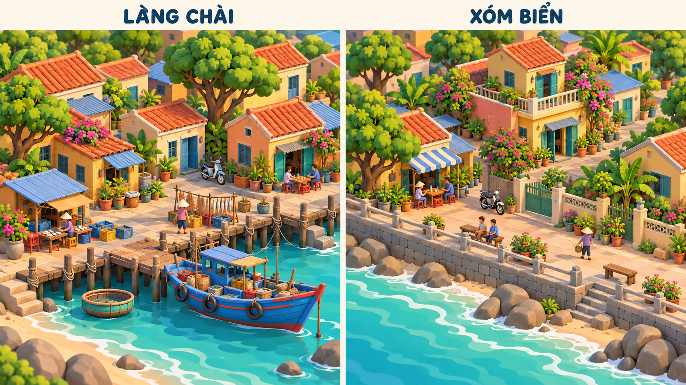
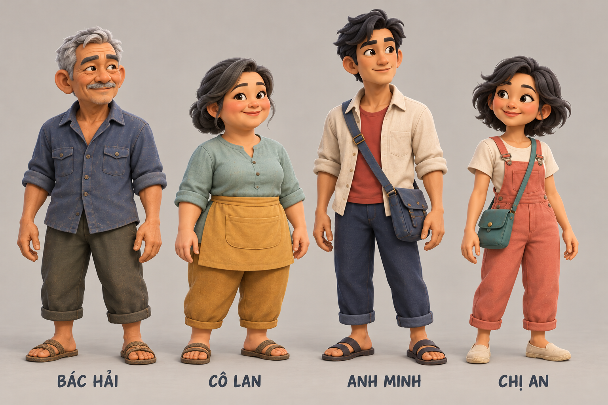
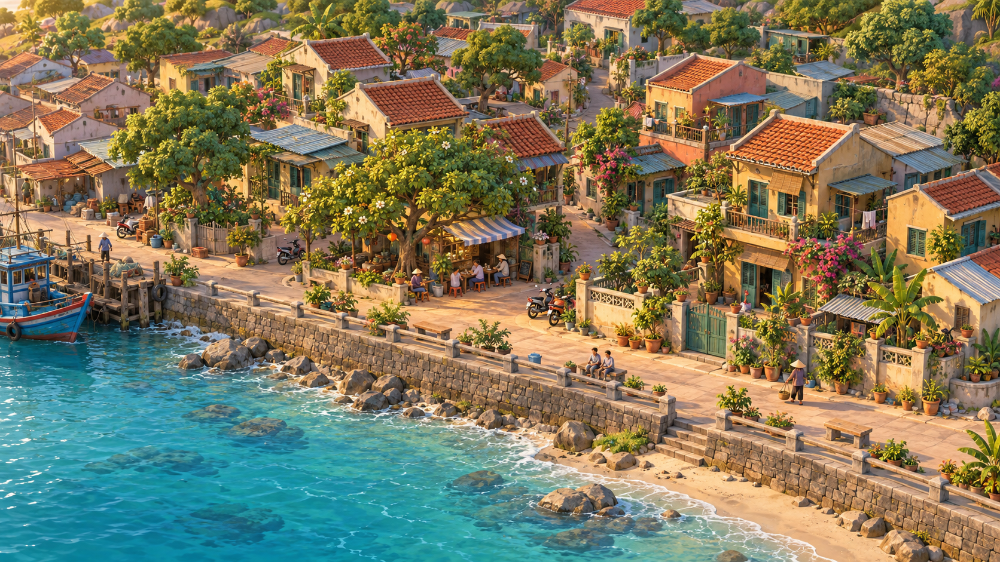
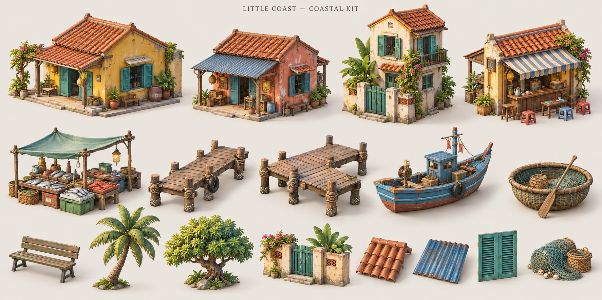
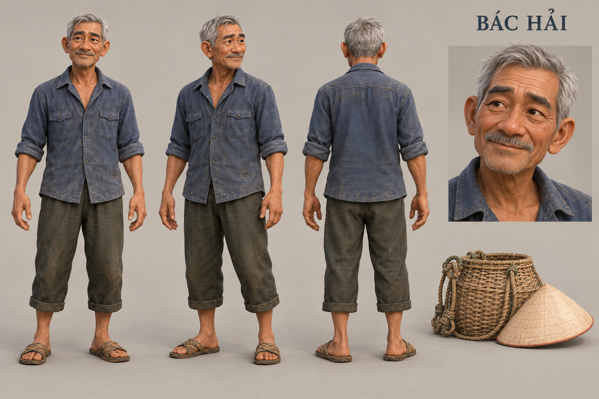
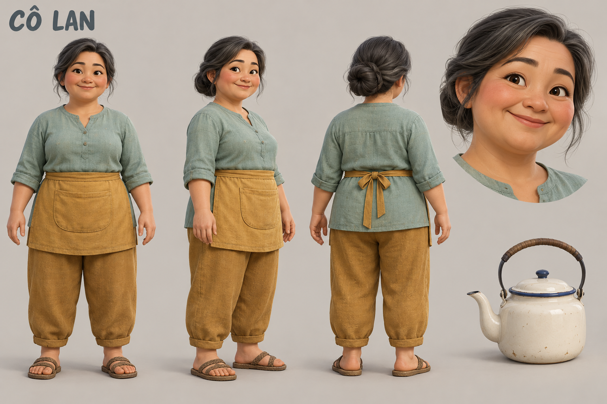
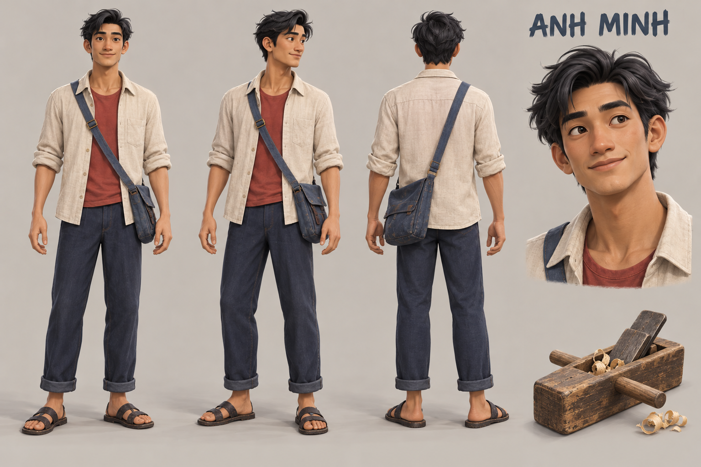
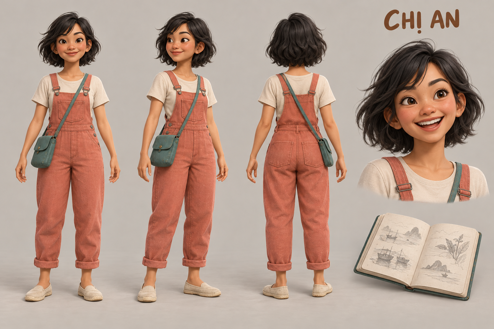

# Little Coast — Visual Development v1

**Ngày:** 22/10/2026. **Giai đoạn hiện tại:** concept + mẫu 3D tích hợp, chưa production art.  
**Nguồn công việc:** người dùng yêu cầu agent đồ họa dùng ImageGen thiết kế nhân vật và bối cảnh trước, sau đó developer dựng theo, vì nhân vật hiện tại chưa có tạo hình riêng và Xóm Biển chưa đúng yêu cầu. Quyền triển khai thông thường đã được giao ở lượt trước tiếp tục có hiệu lực.

## Hướng làm được áp dụng

**Đời sống một xóm biển Việt Nam, hình khối mềm có tính cách, vật liệu có dấu vết sử dụng và các góc sinh hoạt có chủ đích.** Giữ Cozy Stylized 3D đã chốt; nâng mức tạo hình từ các khối minh họa gameplay lên nhân vật/công trình có nhận diện.

Ảnh được tạo bằng **ImageGen built-in**, không dùng CLI/API riêng. Đây là ảnh tham chiếu thiết kế, **chưa phải mesh GLB, rig, texture atlas hoặc ảnh chụp game sau nâng cấp**. Bộ ảnh và các prompt chính xác được lưu cùng repo để dev có cùng nguồn tham chiếu.

**Cập nhật sau yêu cầu “Triển khai đi”:** mẫu Hải + nhà + quán đã dựng bằng Three.js và dùng trực tiếp trong game. Có trang `/art-review.html` để xem đúng các model ấy cạnh concept. 47 Node tests và production build đạt; browser smoke có ảnh thật. [ART_SAMPLE_REPORT.md](./ART_SAMPLE_REPORT.md) là trạng thái/bằng chứng mới nhất; [CHARACTER_MODEL_SAMPLE.md](./CHARACTER_MODEL_SAMPLE.md), [BUILDING_MODEL_SAMPLE.md](./BUILDING_MODEL_SAMPLE.md) và [ART_SAMPLE_QA.md](./ART_SAMPLE_QA.md) ghi API, số đo và review. Những mô tả “chưa triển khai” bên dưới chỉ ghi lại ranh giới của increment concept trước đó.

## Những vấn đề phải sửa ở bản dựng hiện tại

| Quan sát từ mã/cảnh hiện tại | Mục tiêu art mới | Cách nghiệm thu lúc dựng lại |
| --- | --- | --- |
| NPC dùng cùng đầu hình cầu, thân trụ, nón lá; khác màu theo index | Bốn silhouette, khuôn mặt, tóc và trang phục riêng, gắn theo ID ổn định | Nhận ra Hải/Lan/Minh/An khi đổi thứ tự mảng cư dân; zoom gần có mặt/tóc rõ; góc xa còn phân biệt dáng/màu |
| NPC quá nhỏ so với nhà/camera; thêm chi tiết mặt sẽ khó nhìn thấy | Tỷ lệ người–nhà và mức zoom cần được thử cùng nhau | Một cảnh có người, cửa nhà, ghế và quán ở cùng tỷ lệ; không chỉ so ảnh chân dung cận mặt |
| Nhà gần như cùng một khối và một mái | Bộ module có biến thể mái, hiên, cửa/chớp, sân, mảng vật liệu | Tối thiểu một mẫu nhà và quán khớp hình dáng/vật liệu trước khi nhân rộng |
| Đất cát rộng, phẳng, nhạt; không gian sinh hoạt rời rạc | Phân lớp nền đất/cát/lối đi/sân; bóng râm, hàng rào thấp, cây và cụm vật dụng có vị trí hợp lý | Scene dễ đọc đường và cửa; chi tiết không thành chướng ngại vô hình, không che footprint |
| Xóm Biển mới là phần grid mở thêm | Bản sắc khu dân cư ven biển: nhà thấp tầng, hiên/ban công, ngõ có cây, quán và lối dạo sát biển | Cảnh so sánh hai Region thấy khác về cấu trúc và nhịp sống, vẫn thuộc cùng một thế giới |

Không giải quyết bằng cách tăng số lượng chi tiết nhỏ ngẫu nhiên trên cùng model cũ. Ưu tiên silhouette, tỷ lệ, phân bố màu/sáng và cấu trúc không gian trước.

## Ngôn ngữ hình khối và vật liệu

- Nhân vật khoảng 4–4.5 đầu cao làm điểm xuất phát; thân người có khối vai/hông rõ, tay chân và khuôn mặt đủ biểu cảm. Tỷ lệ cuối chọn qua cảnh gameplay, không ép con số từ ảnh concept thành kích thước engine.
- Không dùng nón lá giống nhau cho mọi nhân vật. Tóc, dáng đứng, trang phục và phụ kiện phải đủ để nhận ra từng người khi không đội nón.
- Công trình có khối chính rõ, mái ngói/tôn và hiên tạo nhịp; vật liệu vữa, gỗ, ngói, kim loại sơn cũ đọc được ở mức vừa đủ. Không dùng bề mặt nhựa bóng cho mọi thứ hoặc noise che hình.
- Palette khuyến nghị: xanh chàm `#3E5868`, xanh biển `#579B9A`, xanh lá dịu `#6E8964`, đất nung `#B9694B`, vàng vữa `#D8B77A`, trắng vải `#EFE6D5`. Đây là hướng vật liệu/điểm nhấn, không phải kết quả đo pixel của ảnh.
- Ánh sáng mềm có hướng, tương phản giúp người/đồ vật tách nền; không phủ bloom/sương trắng đến mức mất màu. Sau scene ban ngày cần đối chứng hoàng hôn/mưa để bảo vệ khả năng đọc.

## Cast — nhận diện thị giác

Các tên/ID giữ đúng bản thử hiện tại. Nghề nghiệp, tuổi và phụ kiện chi tiết dưới đây là lựa chọn tạo hình trong đợt art này; không tự thêm hệ thống nghề nghiệp, nhiệm vụ hoặc lore đã phê duyệt.

| ID | Tạo hình đích | Dấu hiệu nhận ra ở xa | Cử chỉ gợi ý, cần làm animation riêng |
| --- | --- | --- | --- |
| `hai` — Bác Hải | Người lớn tuổi, rám nắng, tóc bạc ngắn, ria nhẹ; áo chàm xắn tay, quần ô-liu, dép; nón/giỏ là phụ kiện tách | Vai chắc, dáng hơi khom, mảng áo chàm và đầu bạc | Bước chậm chắc, nhìn ra bến, chỉnh tay áo |
| `lan` — Cô Lan | Dáng tròn ấm áp, tóc búi thấp; áo xanh biển dịu, quần đất vàng và tạp dề ngắn | Khối thân tròn hơn, búi tóc và mảng vàng tạp dề | Đứng thư thái, chào khách; ấm trà là đạo cụ tùy hoạt động |
| `minh` — Anh Minh | Cao gầy, tóc rẽ bên; sơ mi ngoài màu vải sáng, áo trong đỏ đất, quần chàm và túi vải xanh | Dáng cao hẹp, áo sáng mở phía trước, túi đeo | Đi gọn, đứng quan sát; không biến dụng cụ thành vật luôn dính tay |
| `an` — Chị An | Thấp nhỏ linh hoạt, tóc bob gợn; áo sáng, quần yếm san hô, túi xanh | Dáng gọn, tóc ngắn rộng và khối quần san hô | Bước nhẹ, ngồi xem sổ nếu có animation/socket phù hợp |

Model sheets và prompt từng nhân vật: [CHARACTER_DESIGNS.md](./CHARACTER_DESIGNS.md). **Ảnh lineup chung dưới đây chi phối tỷ lệ và mức stylization**; bốn sheet riêng giữ thông tin nhận diện/trang phục và góc sau, không phải tỷ lệ production để sao chép nguyên xi. Lineup vẫn có Minh dài người hơn đích và một ít texture vải nhỏ; mẫu 3D cần chuẩn hóa trước khi sản xuất batch.

## Hai Region — cùng thế giới, khác bản sắc

| Thuộc tính | Làng Chài | Xóm Biển |
| --- | --- | --- |
| Vai trò không gian | Xóm làm nghề biển, chỗ tàu và ngư cụ gặp đời sống gia đình | Khu ở ven biển nối tiếp, đời sống xóm và lối dạo |
| Khối kiến trúc | Nhà thấp, mái ngói/tôn xen kẽ, sân làm việc và mái che | Nhà 1–2 tầng, hiên/ban công, cửa chớp, sân trồng cây |
| Khoảng chung | Bến, lối xuống nước, bóng cây, góc lưới/giỏ/thúng | Ngõ mát, quán nước, ghế nghỉ, tường thấp và promenade |
| Chất liệu/chi tiết | Gỗ dùng lâu, vữa ấm, sơn tàu, dây/lưới có điểm tập trung | Vữa ấm sáng hơn, mảng sơn xanh/san hô, cây chậu và bậc hiên |
| Phải tránh | Cảng công nghiệp, resort hoặc một bãi cát trống với nhà clone | Cao ốc, khu phố hiện đại đè bản sắc làng cũ, Santorini hoặc ngoại ô kiểu Mỹ |

Keyframe là **đích không khí/bố cục khi khu đã phát triển**, không phải lệnh seed thêm nhà có người vào save hiện tại. Phần mainland, đường bờ và silhouette cảnh xa cần được làm rõ khi thiết kế map thực; không biến bản đồ thành đảo nổi chỉ để dễ chụp ảnh.

## Bộ ảnh concept

### Chuẩn phong cách bối cảnh để dev dựng theo

Ảnh này chi phối hình khối lớn, vật liệu matte và độ đơn giản của nước/cảnh quan. Hai keyframe chi tiết phía dưới là tham chiếu bố cục, nhịp sống và motif địa phương; không dùng độ photoreal của chúng làm yêu cầu texture/shader runtime. Cây vẫn cần gom tán rõ hơn ở bước dựng model. Không phải bản vẽ orthographic có thể đo kích thước trực tiếp.

### Chuẩn phong cách chung của bốn nhân vật

### Làng Chài — keyframe

### Xóm Biển — keyframe

### Bộ module công trình và vật thể

### Bác Hải

### Cô Lan

### Anh Minh

### Chị An

## Từ ảnh sang bản dựng thật

1. Art Director kiểm tra bộ ảnh: nhất quán style, cast không bị giống nhau, đúng vai trò hai Region, có hình đủ rõ để dựng. Sai lệch trong ảnh phải ghi lại thay vì bắt dev đoán.
2. Dev/Technical Art làm một lát cắt nhỏ: Bác Hải + một nhà + quán + đoạn đường/ghế cùng tỷ lệ. Dựng hình theo concept rồi kiểm tra bằng camera đang chơi.
3. So sánh screenshot runtime và concept theo silhouette, tỷ lệ, màu/vật liệu, ánh sáng và độ đọc. Chỉ qua bước này mới nhân rộng cast/bộ module và bố cục Region.
4. Asset 3D thực phải có mesh/material/pivot/animation phù hợp; không dán ảnh concept làm nền hoặc dùng billboard thay người trong cảnh có thể xoay tự do để tuyên bố đã đạt art.

Hợp đồng kỹ thuật, task tiếp theo và tiêu chí nghiệm thu: [DEV_HANDOFF.md](./DEV_HANDOFF.md). Chi tiết môi trường/prompt: [ENVIRONMENT_DESIGNS.md](./ENVIRONMENT_DESIGNS.md). Danh sách ảnh và metadata thực: [asset-manifest.json](./asset-manifest.json).

**Ranh giới hoàn thành đợt này:** có ảnh concept thật, prompt tái tham khảo, nhận diện cast/Region và handoff để dev dựng theo. Không gọi ảnh concept là model 3D/rig hoặc coi scene đang chạy đã được nâng cấp chỉ vì có bộ ảnh mới.

## Kiểm tra ảnh và trạng thái bàn giao

Studio Lead đã mở kiểm tra **9 ảnh chính** tại workspace: 5 ảnh cast và 4 ảnh môi trường. Các file đều được giữ ở `assets/concepts/`, không tham chiếu riêng tới thư mục ảnh mặc định của công cụ. Prompt đầy đủ và chế độ built-in ghi trong hai tài liệu chuyên môn; metadata và SHA-256 ở manifest.

- Nhận diện cast: đạt mức concept — khác silhouette/tóc/trang phục/phụ kiện, không đội nón giống nhau. Chưa có side profile thật hoặc mesh turnaround; vẫn cần dựng mặt bên và chuẩn hóa tỷ lệ.
- Hai Region: đạt mức concept — bến/đồ nghề/lưới/thúng phân biệt với hiên/ban công/sân cây/quán/lối dạo. Chưa là layout kỹ thuật hoặc world snapshot thật.
- Style: có hai master chung để khắc phục độ photoreal và tỷ lệ không nhất quán của những ảnh chi tiết. Tránh sao chép noise vải, vữa, số lượng lá/hoa nhỏ vào model đầu tiên.
- `lang-chai-study-v0.png` là **nghiên cứu không chọn làm visual target** vì góc xa/độ photoreal; được giữ riêng cho truy vết, không thuộc 9 ảnh chính trong gallery.
- Không thay đổi `src/`, simulation/save hay asset runtime ở đợt concept này; không chạy lại test gameplay khi không đổi hành vi. Chưa có GLB, rig, animation mới hoặc browser screenshot sau nâng cấp art.

**ART-DEV-01:** reference QA complete. **ART-DEV-02/03:** procedural sample implemented. **ART-DEV-04/05:** tích hợp và kiểm tra một phần, giới hạn trong báo cáo mẫu. **ART-DEV-06:** chưa sản xuất batch; Xóm Biển mới có palette variant, chưa có bố cục/kit toàn vùng. Đây là review của studio, chưa có human playtest hoặc nghiệm thu art cuối.
